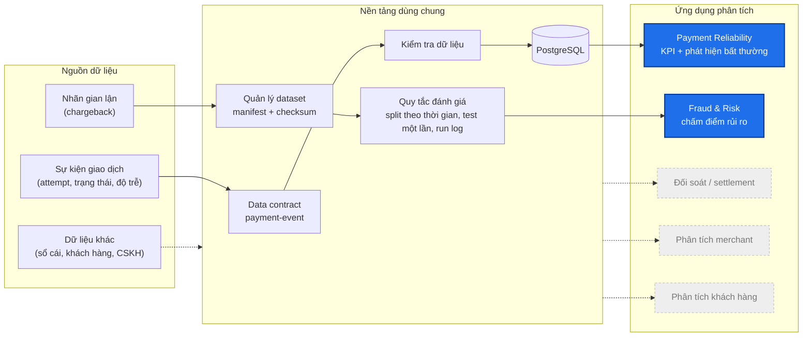
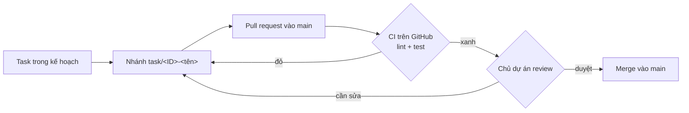

# Payment Intelligence Ecosystem

[](https://github.com/TrungTuyenDo02/Payment_Intelligence_Ecosystem/actions/workflows/ci.yml)


Đây là đề tài thực tập của mình: xây một nền tảng dữ liệu nhỏ cho mảng thanh toán, trên đó chạy hai ứng dụng phân tích. Ứng dụng thứ nhất theo dõi **độ ổn định của hệ thống thanh toán**. Ứng dụng thứ hai **chấm điểm rủi ro gian lận** cho từng giao dịch.

Dự án là một bản demo làm trong 6 tuần và chạy hoàn toàn trên máy cá nhân bằng Docker. Mình ưu tiên **cách đánh giá đúng** hơn là điểm số cao: không rò rỉ dữ liệu, chạy lại ra cùng kết quả, và báo cáo đúng những gì đã chạy.

---

## 1. Bức tranh tổng thể

Một công ty thanh toán sinh ra rất nhiều dữ liệu, và có nhiều bài toán phân tích có thể làm trên đó. Sơ đồ dưới đây là toàn cảnh. Hai khối tô đậm là phần đề tài này làm.



Các khối màu xám (đối soát, phân tích merchant, phân tích khách hàng) chỉ để minh hoạ vị trí của đề tài trong một hệ thống lớn hơn. Đề tài này **không** làm các khối đó.

## 2. Vì sao chọn hai hệ thống này

| | **Payment Reliability** | **Fraud & Risk** |
| --- | --- | --- |
| Câu hỏi trả lời | Hệ thống thanh toán có đang chạy ổn không? | Giao dịch này có đáng nghi không? |
| Người dùng | Đội vận hành, kỹ thuật | Đội rủi ro, điều tra |
| Dữ liệu | Dữ liệu giả lập theo contract `payment-event` | Dataset công khai IEEE-CIS (Kaggle, có nhãn) |
| Loại bài toán | Chuỗi thời gian, phát hiện bất thường (không có nhãn sẵn) | Phân loại có nhãn, mất cân bằng lớp (gian lận khoảng 3,5%) |

Lý do chọn:

1. **Hai câu hỏi cốt lõi của vận hành thanh toán.** Hệ thống có chạy không và giao dịch có an toàn không. Hầu hết các bài toán khác đều cần hai thứ này trước.
2. **Có dữ liệu làm được mà không đụng tới dữ liệu thật.** Fraud có dataset công khai có nhãn. Reliability tự sinh được dữ liệu vì chỉ cần mô phỏng trạng thái và độ trễ của giao dịch. Các mảng như đối soát hay phân tích khách hàng cần sổ cái hoặc dữ liệu khách hàng thật, mà dữ liệu đó không có bản công khai phù hợp.
3. **Hai kiểu bài toán khác nhau.** Một bên không có nhãn và làm trên chuỗi thời gian, một bên có nhãn và rất mất cân bằng. Làm cả hai cho thấy được nhiều kỹ năng hơn mà vẫn vừa sức 6 tuần.
4. **Dùng chung được nền tảng.** Contract, quản lý dataset, quy tắc đánh giá và hạ tầng được viết một lần, cả hai sản phẩm cùng dùng.

**Giới hạn cần nói rõ:** hai sản phẩm **không dùng chung dữ liệu**. Không có dataset công khai nào vừa có dữ liệu vận hành vừa có nhãn gian lận với cùng khoá giao dịch. Trong hệ thống thật, hai bên sẽ nối với nhau qua `payment_id`, và contract đã giữ sẵn trường này. Chi tiết ở [ADR 0002](docs/decisions/0002-product-boundaries.md).

## 3. Kiến trúc trong repo

```mermaid
flowchart TD
    subgraph P02["Fraud & Risk (Stage B, E)"]
        A1["datasets/raw/ieee-cis/<br/>(tự tải, không commit)"] --> A2["Manifest + SHA-256"]
        A2 --> A3["Adapter IEEE-CIS<br/>X (không nhãn), y, time"]
        A3 --> A4["Chia theo thời gian<br/>60 / 20 / 20"]
        A4 --> A5["EDA trên train<br/>→ eda-summary.md (duyệt)"]
        A4 --> A6["Baseline luật<br/>Logistic Regression"]
        A6 --> A7["Metrics<br/>ngưỡng chọn trên validation"]
        A7 --> A8["Run log<br/>artifacts/runs/&lt;run_id&gt;/"]
    end

    subgraph P01["Payment Reliability (Stage C, D)"]
        B1["Config kịch bản<br/>+ seed"] --> B2["Bộ sinh dữ liệu<br/>sự kiện + bất thường chèn vào"]
        B2 --> B3["Kiểm tra contract"]
        B3 --> B4[("PostgreSQL")]
        B4 --> B5["KPI: tỷ lệ thành công,<br/>độ trễ, lỗi theo provider"]
        B5 --> B6["Phát hiện bất thường<br/>so với ground truth"]
    end

    B2 -. "nhãn bất thường<br/>để riêng" .-> B6
```



Phần Fraud & Risk đã có code. Phần Payment Reliability đang ở bước đặc tả ([`stage-c-spec.draft.md`](docs/architecture/stage-c-spec.draft.md)).

## 4. Kế hoạch thực hiện

| Tuần | Giai đoạn | Nội dung | Trạng thái |
| --- | --- | --- | --- |
| 1–2 | **A** Nền tảng | Khung repo, Docker + PostgreSQL, contract `payment-event`, công cụ manifest | Code xong; contract đang chờ duyệt |
| 1–2 | **B** Fraud baseline | Adapter IEEE-CIS, split theo thời gian, EDA, metrics, baseline luật và Logistic Regression, run log, test chống rò rỉ | Code xong; chưa chạy đánh giá test |
| 3 | **C** Dữ liệu giả lập | Bộ sinh sự kiện (demo nhỏ, khoảng 5 nghìn payment), chèn bất thường, nạp vào PostgreSQL | Đặc tả nháp, chờ duyệt |
| 4 | **D** Reliability | Bảng KPI, bộ phát hiện bất thường, đánh giá trên bất thường đã biết | Chưa bắt đầu |
| 5 | **E** Fraud nâng cao | Thí nghiệm rò rỉ (chia ngẫu nhiên và chia theo thời gian), Gradient Boosting, khoảng trống thời gian (`gap_days`), API chấm điểm | Chưa bắt đầu |
| 6 | **F** Hoàn thiện | Dashboard, báo cáo thực tập | Chưa bắt đầu |

Mỗi giai đoạn chỉ bắt đầu khi giai đoạn trước đã được review. Kế hoạch đầy đủ, rủi ro và tài liệu tham khảo nằm trong [tổng quan đề tài](docs/product/project-overview.md).

## 5. Kết quả đầu ra

| Giai đoạn | Đầu ra |
| --- | --- |
| A | Contract JSON Schema có test; manifest dataset có checksum |
| B | Bảng EDA (`artifacts/eda/`), 9 quyết định tiền xử lý đã duyệt ([`eda-summary.md`](docs/data-analysis/eda-summary.md)), thư mục run cho mỗi lần chạy baseline |
| C | Sự kiện giả lập tái lập được theo `simulation_id`, file nhãn bất thường riêng, bảng dữ liệu trong PostgreSQL |
| D | Bảng KPI theo thời gian, danh sách bất thường phát hiện được, so sánh với ground truth |
| E | Báo cáo thí nghiệm rò rỉ, kết quả Gradient Boosting, API chấm điểm |
| F | Dashboard và báo cáo thực tập |

Mỗi lần chạy baseline tạo một thư mục `artifacts/runs/<run_id>/` (không commit):

| File | Nội dung |
| --- | --- |
| `config.yaml` | Bản sao config đã dùng |
| `metrics.json` | PR-AUC (kèm khoảng tin cậy 95%), precision, recall, F1, FPR, recall tại precision 0,5, recall tại FPR 5% |
| `split.json` | Mốc thời gian, số dòng, tỷ lệ gian lận của train / validation / test |
| `threshold.json` | Ngưỡng quyết định chọn trên validation |
| `models.json` | Luật với ngưỡng đã học; hệ số Logistic Regression (JSON, không dùng pickle) |
| `environment.txt`, `git_sha.txt`, `manifest_checksum.txt` | Thông tin để chạy lại đúng như cũ |

**Kết quả trên dữ liệu thật: chưa có.** Bảng số liệu sẽ được thêm vào đây sau lần chạy test đầu tiên, kèm `run_id`.

## 6. Hướng dẫn chạy

### Cần chuẩn bị

- Python 3.11 trở lên
- [uv](https://docs.astral.sh/uv/) (khuyến nghị). Không có uv thì Makefile tự dùng `venv` + `pip`.
- Docker và Docker Compose
- `make`, `git`
- Khoảng 8 GB RAM nếu chạy trên toàn bộ IEEE-CIS

### Cài đặt

```bash
git clone https://github.com/TrungTuyenDo02/Payment_Intelligence_Ecosystem.git
```

```bash
cd Payment_Intelligence_Ecosystem
```

```bash
cp .env.example .env
```

Đổi `POSTGRES_PASSWORD` trong `.env`. File `.env` không bao giờ được commit.

```bash
make setup
```

```bash
make lint test
```

```bash
make up
```

`make up` bật PostgreSQL 16 và chờ đến khi healthy. Tắt bằng `make down`.

Lệnh `make test` chỉ dùng dữ liệu tổng hợp nhỏ có sẵn trong repo, nên chạy được ngay mà không cần tải dataset.

### Chuẩn bị dữ liệu IEEE-CIS

1. Đăng nhập Kaggle, chấp nhận điều khoản cuộc thi [IEEE-CIS Fraud Detection](https://www.kaggle.com/c/ieee-fraud-detection), tải dữ liệu về.
2. Đặt file vào `datasets/raw/ieee-cis/` (hoặc đặt biến môi trường `IEEE_CIS_DIR`):

   ```text
   datasets/raw/ieee-cis/
     train_transaction.csv
     train_identity.csv
   ```

   Hai file `test_*.csv` của Kaggle không có nhãn, dự án không dùng chúng. Train, validation và test đều được tách từ các file `train_*` theo thời gian.

3. Tạo manifest để ghi checksum và nguồn gốc:

   ```bash
   PYTHONPATH=shared/dataset-management uv run python -m dataset_management.cli --name ieee-cis --source "Kaggle competition: IEEE-CIS Fraud Detection (https://www.kaggle.com/c/ieee-fraud-detection)" --base-dir datasets/raw/ieee-cis --file train_transaction.csv --file train_identity.csv --download-date YYYY-MM-DD --license-note "Kaggle competition terms, research use only, verify before any other use" --out datasets/manifests/ieee-cis.yaml
   ```

Nếu file dữ liệu bị sửa sau khi tạo manifest, lần chạy sẽ dừng với lỗi `changed since the manifest`.

### Chạy phần Fraud & Risk

1. Chạy EDA trên phần train:

   ```bash
   make eda
   ```

   Đọc các bảng trong `artifacts/eda/`. Mỗi quyết định tiền xử lý được ghi và duyệt trong [`eda-summary.md`](docs/data-analysis/eda-summary.md).

2. Chạy baseline (chỉ dùng train và validation, không đụng tới test):

   ```bash
   make baseline
   ```

3. Khi đã chốt cấu hình, chủ dự án đổi `status: draft` thành `status: frozen` trong `projects/fraud-risk/configs/baseline.yaml`, rồi chạy đánh giá test **một lần**:

   ```bash
   make baseline-final
   ```

   Lệnh này từ chối config chưa `frozen` và config đã từng chạy test. Có thể ép chạy lại bằng `FORCE=1`, nhưng cảnh báo sẽ được ghi vào `metrics.json`.

Muốn dùng config khác thì thêm `CONFIG=path/to/config.yaml` vào lệnh.

### Tất cả lệnh

| Lệnh | Việc |
| --- | --- |
| `make setup` | Tạo môi trường, cài thư viện |
| `make lint` | `ruff check` và `ruff format --check` |
| `make test` | `pytest` kèm coverage |
| `make up` / `make down` | Bật / tắt PostgreSQL |
| `make eda` | EDA trên train, ghi bảng vào `artifacts/eda/` |
| `make baseline` | Hai baseline, đánh giá trên train và validation |
| `make baseline-final` | Đánh giá test một lần cho config đã `frozen` |

## 7. Cách đánh giá (Fraud & Risk)

| Vấn đề | Cách làm |
| --- | --- |
| Chia dữ liệu | Sắp theo `TransactionDT`: 60% đầu là train, 20% tiếp là validation, 20% cuối là test. Không chia ngẫu nhiên, vì chia ngẫu nhiên cho kết quả đẹp giả tạo. |
| Nhãn | Adapter trả về đặc trưng `X` và nhãn `y` riêng. Hàm tạo đặc trưng không nhận được nhãn. |
| Học tham số | Mọi bước tiền xử lý và ngưỡng của luật chỉ học trên train. Ngưỡng quyết định chọn trên validation. |
| Baseline luật | Số tiền lớn hơn phân vị 99% của train; `ProductCD` và `card6` có tỷ lệ gian lận cao (tính trên train). Điểm là tỷ lệ luật bị kích hoạt. |
| Baseline Logistic Regression | Điền thiếu bằng median, chuẩn hoá cột số, one-hot cột phân loại, `class_weight='balanced'`. |
| Metrics | PR-AUC kèm khoảng tin cậy bootstrap, recall tại precision 0,5, recall tại FPR 5%. Không dùng accuracy, vì đoán "không bao giờ gian lận" đã đạt khoảng 96,5%. |
| Tái lập | `run_id` tính từ config (bỏ trường `status`), seed, checksum dataset và mốc split. Cùng đầu vào thì ra cùng `metrics.json`. |

## 8. Quy trình làm việc



- Mỗi task một nhánh, commit nhỏ. Chỉ merge vào `main` qua pull request.
- **CI** ([`.github/workflows/ci.yml`](.github/workflows/ci.yml)) chạy `make lint` và `make test` trên Python 3.11 và 3.13 cho mọi pull request và mỗi lần push lên `main`. Test cũng báo lỗi nếu repo có file dữ liệu, mô hình hoặc `.env` bị commit nhầm.
- Có một số **điểm dừng** chỉ chủ dự án được thông qua:
  - duyệt contract;
  - duyệt quyết định EDA;
  - đặt config thành `frozen`;
  - chạy đánh giá test.
- Thay đổi về kiến trúc hoặc thêm thư viện mới được ghi thành ADR trong [`docs/decisions/`](docs/decisions/).

## 9. Cấu trúc thư mục

```text
.
├── .github/workflows/    # CI: lint + test
├── contracts/
│   ├── payment-event/    # JSON Schema (draft), ví dụ, test, changelog
│   └── risk-context/     # chưa làm
├── shared/
│   ├── dataset-management/   # manifest + checksum
│   ├── synthetic-generator/  # Stage C
│   ├── data-validation/
│   └── common/
├── datasets/
│   ├── manifests/        # một YAML cho mỗi dataset
│   └── raw/              # không commit
├── projects/
│   ├── fraud-risk/       # adapters, eda, features, baselines, evaluation, scripts, configs, tests
│   └── payment-reliability/  # Stage D
├── infrastructure/       # docker, database
├── docs/                 # tổng quan, kiến trúc, quyết định (ADR), phân tích dữ liệu
├── tests/                # test cấu trúc repo và .gitignore
├── artifacts/            # không commit: run, bảng EDA, Parquet
├── compose.yaml
├── Makefile
└── pyproject.toml
```

Code Python nằm trong package snake_case bên trong thư mục có dấu gạch ngang, ví dụ `projects/fraud-risk/fraud_risk/` ([ADR 0001](docs/decisions/0001-package-layout.md)).

## 10. Nguyên tắc dữ liệu

- Không dùng dữ liệu thật hay dữ liệu công ty. Chỉ dùng dataset công khai và dữ liệu giả lập.
- Không có dữ liệu thẻ hay thông tin xác thực trong schema, fixture hay log.
- Không commit dataset, Parquet, file mô hình, bảng EDA hay `.env`.
- Không dùng mô hình pretrained tải từ Internet.
- Điểm rủi ro chỉ để hỗ trợ con người ra quyết định, hệ thống không tự chặn giao dịch.

## 11. Tài liệu

- [Tổng quan đề tài](docs/product/project-overview.md): phạm vi, kế hoạch, rủi ro, tài liệu tham khảo
- [Đặc tả Stage C (nháp)](docs/architecture/stage-c-spec.draft.md)
- [Quyết định tiền xử lý (EDA)](docs/data-analysis/eda-summary.md)
- ADR: [0001 cấu trúc package](docs/decisions/0001-package-layout.md) · [0002 ranh giới hai sản phẩm](docs/decisions/0002-product-boundaries.md) · [0003 độ trễ nhãn](docs/decisions/0003-label-delay-and-entity-overlap.md) · [0004 driver PostgreSQL](docs/decisions/0004-postgres-driver.md)
- [Contract `payment-event`](contracts/payment-event/)

## Giấy phép và tác giả

Mã nguồn theo giấy phép [MIT](LICENSE). Dữ liệu IEEE-CIS theo điều khoản cuộc thi Kaggle và **không** đi kèm repo.

**Đỗ Trung Tuyến** ([@TrungTuyenDo02](https://github.com/TrungTuyenDo02))
