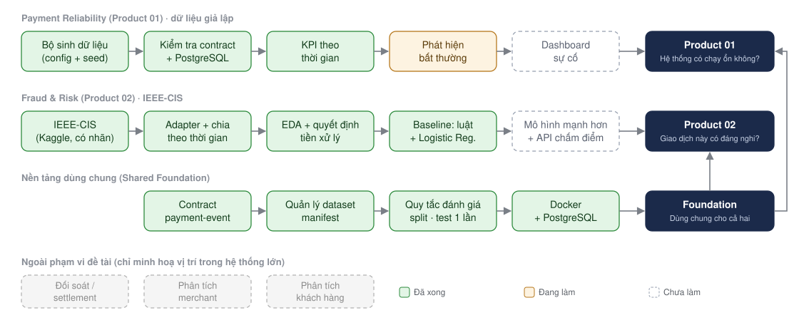
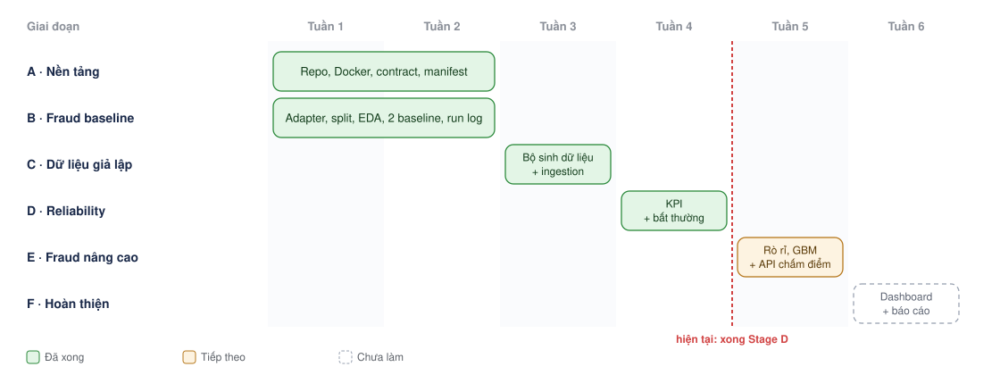
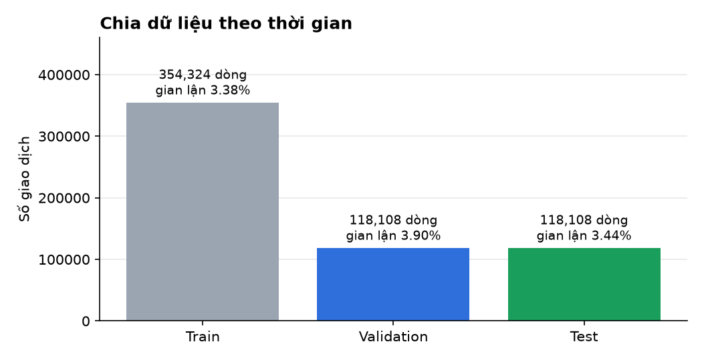
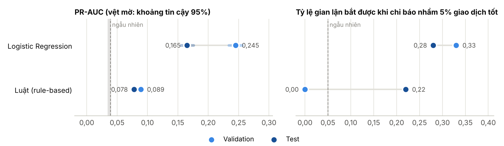
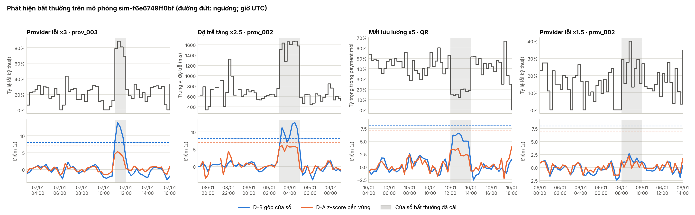
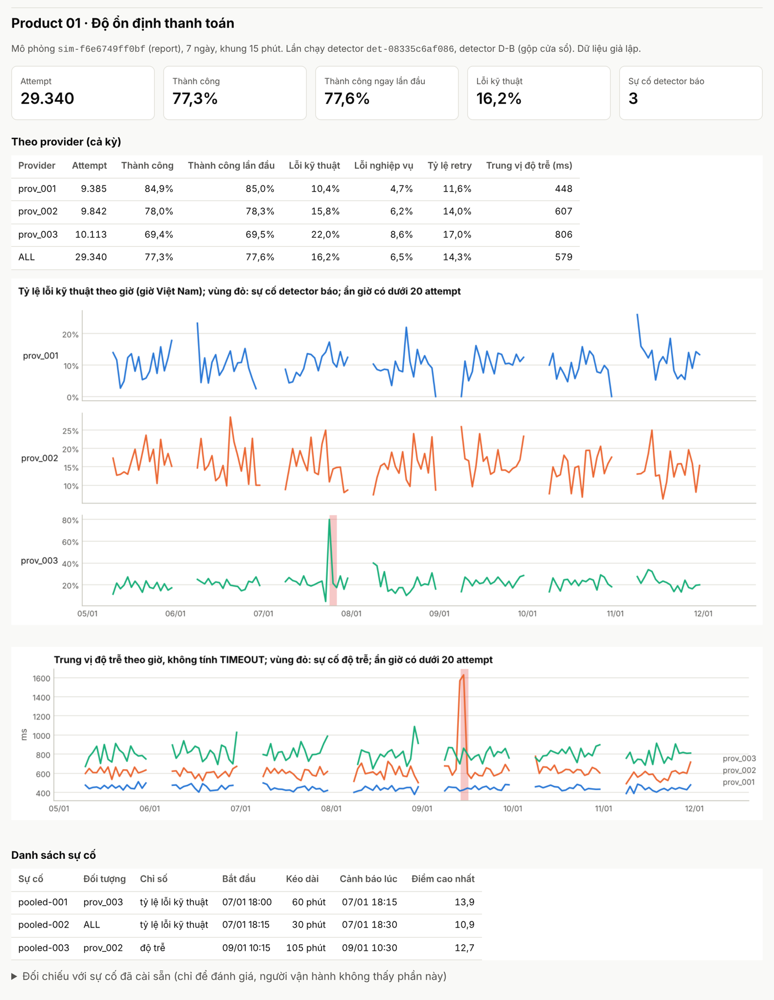
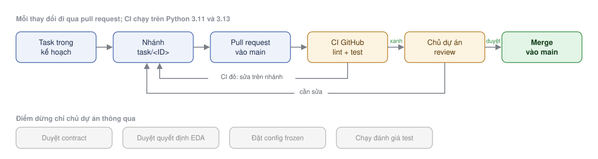

# Payment Intelligence Ecosystem

[](https://github.com/TrungTuyenDo02/Payment_Intelligence_Ecosystem/actions/workflows/ci.yml)


Đề tài thực tập 6 tuần: một nền tảng dữ liệu nhỏ cho mảng thanh toán, trả lời hai câu hỏi của vận hành:

1. **Hệ thống thanh toán có đang chạy ổn không?** Theo dõi KPI và phát hiện bất thường (Product 01, dữ liệu giả lập).
2. **Giao dịch này có đáng nghi không?** Chấm điểm rủi ro gian lận (Product 02, dataset công khai IEEE-CIS).

Không dùng dữ liệu thật của công ty. Toàn bộ chạy trên máy cá nhân bằng Python và Docker.

## Hệ thống

<p align="center"></p>

Hai sản phẩm dùng chung nền tảng (contract dữ liệu, quản lý dataset, quy tắc đánh giá, PostgreSQL) nhưng không dùng chung dữ liệu ([ADR 0002](docs/decisions/0002-product-boundaries.md)).

## Tiến độ

<p align="center"></p>

- **Đã xong (tuần 1–3):** khung repo, contract `payment-event` 1.0.0, hai baseline gian lận đã đánh giá trên tập test, bộ sinh dữ liệu thanh toán giả lập và nạp vào PostgreSQL.
- **Tuần 4 (xong):** KPI độ tin cậy, hai detector, chỉnh ngưỡng trên bộ tuning và đánh giá một lần trên bộ report.
- **Tuần 5 (xong):** thí nghiệm rò rỉ dữ liệu và Gradient Boosting cho Product 02, test đã chạy một lần ([báo cáo Stage E](docs/architecture/stage-e-report.md)).
- **Tuần 6 (xong):** dashboard HTML cho cả hai sản phẩm (`make dashboard`), báo cáo thực tập và bài báo khoa học (PDF).

## Kết quả đến nay

| Giai đoạn | Kết quả | Trạng thái |
| --- | --- | --- |
| A, B · Baseline gian lận | Logistic Regression PR-AUC test 0,165, luật 0,078 (`run-d6faa4699008`) | ✅ Xong, test đã chạy một lần |
| C · Dữ liệu giả lập | 2 bộ 7 ngày, khoảng 25 nghìn payment mỗi bộ, nạp PostgreSQL không lỗi | ✅ Xong |
| D · KPI và detector | Detector chính bắt 2/4 sự cố trên bộ report, 0 báo nhầm (`det-08335c6af086`) | ✅ Xong, report đã chạy một lần |
| E · Rò rỉ, Gradient Boosting | Gradient Boosting PR-AUC test 0,408 (`run-f8807cb6f780`); rò nhãn qua mã hoá `card1` +0,063 (`leak-827d929eaa73`) | ✅ Xong, test đã chạy một lần |
| F · Dashboard, báo cáo | `make dashboard`, [báo cáo PDF](docs/report/bao-cao-thuc-tap.pdf) | ✅ Xong |

**Product 02: phát hiện gian lận trên IEEE-CIS.** Dữ liệu được chia theo thời gian: mô hình học trên phần cũ, được đánh giá trên phần mới hơn, giống như khi chạy thật.

<p align="center"></p>
<p align="center"></p>

- **Logistic Regression tốt hơn baseline luật.** PR-AUC trên test là 0,165, gấp khoảng 4,8 lần mô hình đoán ngẫu nhiên. Baseline luật đạt 0,078.
- **Kết quả giảm từ validation sang test.** Dữ liệu thay đổi theo thời gian, nên con số trên validation lạc quan hơn thực tế. Đây là lý do tập test chỉ được mở **một lần**, với cấu hình đã chốt trước.
- Bảng số đầy đủ: [`summary.md`](docs/assets/results/summary.md) (lần chạy `run-d6faa4699008`).

**Product 01: dữ liệu thanh toán giả lập.** Mỗi lần mô phỏng 7 ngày tạo khoảng 25 nghìn payment (khoảng 30 nghìn sự kiện, có retry), với 4 sự cố được cài sẵn, trong đó có một sự cố yếu để thử giới hạn của detector. Mọi sự kiện qua kiểm tra contract và được nạp vào PostgreSQL không lỗi. Detector được chỉnh ngưỡng trên một bộ dữ liệu (tuning), rồi đánh giá **một lần** trên bộ khác (report) có seed khác và một loại sự cố chưa gặp:

| Detector | Tuning: bắt được / báo nhầm mỗi ngày | Report: bắt được / báo nhầm mỗi ngày |
| --- | --- | --- |
| Gộp cửa sổ, tính theo số attempt (chính) | 3/4 · 0 | **2/4 · 0** |
| z-score bền vững (đường cơ sở) | 2/4 · 1,0 | 0/4 · 2,0 |

Detector chính bắt được sự cố về lỗi và độ trễ trong 15–30 phút và không báo nhầm. Nó trượt sự cố mất lưu lượng (loại chưa gặp khi chỉnh ngưỡng) và sự cố yếu x1,5. Chi tiết: [báo cáo Stage D](docs/architecture/stage-d-report.md).

<p align="center"></p>

**Dashboard** (`make dashboard`): một trang HTML tĩnh cho cả hai sản phẩm, mở được không cần mạng. Ảnh dưới là phần Product 01 trên bộ report.

<p align="center"></p>

**Product 02, Stage E:** cùng 20 đặc trưng và cùng cách chia ([báo cáo Stage E](docs/architecture/stage-e-report.md)).

| Mô hình | PR-AUC validation | PR-AUC test | Recall @ FPR 5% (test) | Lần chạy |
| --- | --- | --- | --- | --- |
| Logistic Regression | 0,245 | 0,165 | 0,28 | `run-d6faa4699008` |
| Gradient Boosting | 0,497 | **0,408** [0,390; 0,424] | **0,51** | `run-f8807cb6f780` |

- **Gradient Boosting gấp khoảng 2,5 lần Logistic Regression trên test**, khoảng tin cậy không giao nhau. Tổ hợp tốt nhất nằm ở cạnh lưới, nên chưa biết tăng số cây có tốt hơn không.
- **Thí nghiệm rò rỉ** (chỉ trên validation, `leak-827d929eaa73`): mã hoá `card1` bằng nhãn validation làm PR-AUC tăng 0,063. Tiền xử lý trên mọi dòng và khoảng trống 7–14 ngày không tạo khác biệt đo được. Chia ngẫu nhiên lại làm PR-AUC *giảm* 0,068, mới giải thích được khoảng một phần ba.

## Nguyên tắc

- **Đánh giá trung thực hơn điểm cao:** chia theo thời gian, không xáo trộn; mọi phép biến đổi chỉ học trên train; tập test dùng một lần.
- **Tái lập được:** cùng config, seed và dữ liệu cho cùng kết quả; mỗi lần chạy lưu config, checksum dữ liệu và metric.
- **Không dữ liệu thật, không dữ liệu thẻ:** chỉ dataset công khai và dữ liệu tự sinh.

## Chạy thử

Cần Python 3.11+, [uv](https://docs.astral.sh/uv/), Docker và `make`.

```bash
git clone https://github.com/TrungTuyenDo02/Payment_Intelligence_Ecosystem.git
```

```bash
cd Payment_Intelligence_Ecosystem && cp .env.example .env
```

```bash
make setup
```

```bash
make lint test
```

`make test` chỉ dùng dữ liệu tổng hợp nhỏ có sẵn trong repo, không cần tải dataset.

<details>
<summary>Các lệnh khác và cách chạy với dữ liệu thật</summary>

| Lệnh | Việc |
| --- | --- |
| `make up` / `make down` | Bật / tắt PostgreSQL 16 |
| `make simulate` | Sinh dữ liệu thanh toán giả lập vào `artifacts/simulations/<simulation_id>/` (`CONFIG=...` để chọn kịch bản) |
| `make db-init` / `make ingest SIM=<simulation_id>` | Tạo bảng và view KPI / nạp một lần mô phỏng vào PostgreSQL |
| `make kpi SIM=<simulation_id>` | Xuất KPI 15 phút ra Parquet |
| `make tune` / `make detect` / `make detect-plot` | Chỉnh ngưỡng, chạy detector, vẽ biểu đồ (chỉ trên bộ tuning) |
| `make detect-report` | Đánh giá một lần trên bộ report, chỉ với config detector đã `frozen` (chỉ chủ dự án chạy) |
| `make eda` | EDA trên phần train của IEEE-CIS |
| `make baseline` | Hai baseline, đánh giá trên validation |
| `make baseline-final` | Đánh giá test một lần, chỉ với config đã `frozen` (chỉ chủ dự án chạy) |
| `make report` | Vẽ biểu đồ và bảng số cho lần chạy gần nhất (`RUN_DIR=...` để chọn lần khác) |
| `make leakage` | Thí nghiệm rò rỉ dữ liệu (chỉ trên validation) |
| `make dashboard` | Dashboard HTML cho cả hai sản phẩm, ghi vào `artifacts/dashboard/index.html` |
| `make gbm` / `make gbm-final` | Gradient Boosting trên validation / đánh giá test một lần với config đã `frozen` (chỉ chủ dự án chạy) |

**Dữ liệu IEEE-CIS:** tải [IEEE-CIS Fraud Detection](https://www.kaggle.com/c/ieee-fraud-detection) từ Kaggle (cần đăng nhập và chấp nhận điều khoản cuộc thi), đặt `train_transaction.csv` và `train_identity.csv` vào `datasets/raw/ieee-cis/` (không commit). Tạo manifest checksum:

```bash
PYTHONPATH=shared/dataset-management uv run python -m dataset_management.cli --name ieee-cis --source "Kaggle competition: IEEE-CIS Fraud Detection (https://www.kaggle.com/c/ieee-fraud-detection)" --base-dir datasets/raw/ieee-cis --file train_transaction.csv --file train_identity.csv --download-date YYYY-MM-DD --license-note "Kaggle competition terms, research use only, verify before any other use" --out datasets/manifests/ieee-cis.yaml
```

Sau đó chạy `make eda`, `make baseline`, `make report`.

</details>

<details>
<summary>Quy trình làm việc</summary>

<p align="center"></p>

Mỗi pull request được [CI](.github/workflows/ci.yml) chạy `make lint` và `make test` trên Python 3.11 và 3.13, và chặn việc lỡ commit dataset, file mô hình hoặc `.env`.

</details>

## Tài liệu

| Tài liệu | Nội dung |
| --- | --- |
| [Bài báo khoa học (PDF)](docs/report/bai-bao-khoa-hoc.pdf) · [Báo cáo thực tập (PDF)](docs/report/bao-cao-thuc-tap.pdf) · [mã LaTeX](docs/report/latex/) | Bài báo 10 trang; báo cáo đầy đủ có giải thích kiến thức nền |
| [Hướng dẫn thao tác GitHub](docs/github-guide.md) | Nhánh, PR, merge, dọn nhánh, git hook |
| [Tổng quan đề tài](docs/product/project-overview.md) | Bài toán, phạm vi, kế hoạch, rủi ro, tài liệu tham khảo |
| [Bàn giao công việc](HANDOFF.md) | Trạng thái hiện tại và việc tiếp theo |
| [Quyết định tiền xử lý (EDA)](docs/data-analysis/eda-summary.md) | 9 quyết định đã duyệt và bằng chứng |
| [Đặc tả](docs/architecture/stage-c-spec.md) · [Báo cáo](docs/architecture/stage-c-report.md) Stage C | Bộ sinh dữ liệu giả lập và ingestion |
| [Đặc tả](docs/architecture/stage-d-spec.md) · [Báo cáo](docs/architecture/stage-d-report.md) Stage D | KPI độ tin cậy và phát hiện bất thường |
| [Đặc tả](docs/architecture/stage-e-spec.md) · [Báo cáo](docs/architecture/stage-e-report.md) Stage E | Thí nghiệm rò rỉ dữ liệu, Gradient Boosting |
| [Contract `payment-event`](contracts/payment-event/) | JSON Schema 1.0.0 và changelog |
| [Đặc tả Stage F](docs/architecture/stage-f-spec.md) · [Dàn ý báo cáo](docs/report/report-outline.md) | Dashboard, báo cáo thực tập |
| [ADR](docs/decisions/) | Các quyết định kiến trúc (0001–0007) |

## Giấy phép

Mã nguồn theo giấy phép [MIT](LICENSE). Dữ liệu IEEE-CIS theo điều khoản cuộc thi Kaggle và không đi kèm repo.

**Đỗ Trung Tuyến** · [@TrungTuyenDo02](https://github.com/TrungTuyenDo02)
