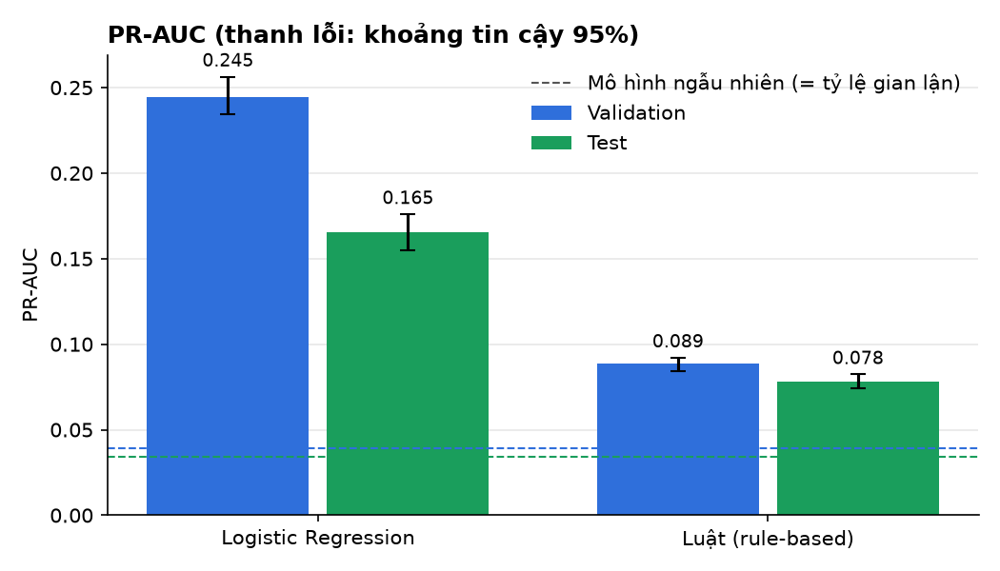
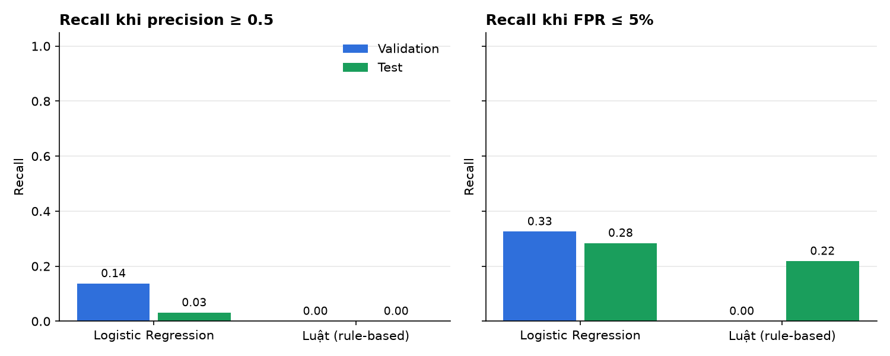

# Payment Intelligence Ecosystem

[](https://github.com/TrungTuyenDo02/Payment_Intelligence_Ecosystem/actions/workflows/ci.yml)


Một nền tảng dữ liệu nhỏ cho mảng thanh toán, trên đó chạy hai ứng dụng: **theo dõi độ ổn định của hệ thống thanh toán** và **chấm điểm rủi ro gian lận**. Đây là đề tài thực tập 6 tuần, chạy hoàn toàn trên máy cá nhân bằng Docker.

## Hệ thống

<p align="center"></p>

Đề tài chọn hai sản phẩm vì:

- **Đây là hai câu hỏi cốt lõi của vận hành thanh toán:** hệ thống có đang chạy ổn không, và giao dịch này có đáng nghi không.
- **Làm được mà không cần dữ liệu thật:** Fraud có dataset công khai có nhãn (IEEE-CIS), còn Reliability có thể tự sinh dữ liệu. Các mảng màu xám trong sơ đồ cần sổ cái hoặc dữ liệu khách hàng thật.
- **Hai kiểu bài toán bổ sung cho nhau:** phát hiện bất thường trên chuỗi thời gian, và phân loại có nhãn với dữ liệu mất cân bằng.

Hai sản phẩm dùng chung nền tảng nhưng không dùng chung dữ liệu ([ADR 0002](docs/decisions/0002-product-boundaries.md)).

## Kế hoạch

<p align="center"></p>

Chi tiết từng giai đoạn, rủi ro và tài liệu tham khảo: [tổng quan đề tài](docs/product/project-overview.md).

## Kết quả

Đánh giá cuối trên IEEE-CIS, lần chạy `run-d6faa4699008` (config `frozen`, commit `fa34646`). Tập test chỉ được mở một lần cho config này.

| Mô hình | Tập | PR-AUC [95% CI] | Tỷ lệ gian lận | Recall @ precision 0,5 | Recall @ FPR 5% |
| --- | --- | --- | --- | --- | --- |
| Logistic Regression | Validation | 0,245 [0,234; 0,256] | 3,90% | 0,14 | 0,33 |
| Logistic Regression | **Test** | **0,165 [0,155; 0,176]** | 3,44% | 0,03 | 0,28 |
| Luật (rule-based) | Validation | 0,089 [0,084; 0,092] | 3,90% | 0,00 | 0,00 |
| Luật (rule-based) | **Test** | **0,078 [0,074; 0,082]** | 3,44% | 0,00 | 0,22 |

- **Logistic Regression tốt hơn baseline luật** trên cả hai tập. Trên test, PR-AUC gấp khoảng 4,8 lần mô hình ngẫu nhiên (bằng tỷ lệ gian lận, 0,034); trên validation là khoảng 6,3 lần.
- **Kết quả giảm từ validation sang test.** Recall tại FPR 5% (không phụ thuộc tỷ lệ gian lận) giảm từ 0,33 xuống 0,28, nên mức giảm không chỉ do tỷ lệ gian lận thấp hơn. Đây là dấu hiệu dữ liệu thay đổi theo thời gian. Recall khi giữ precision ≥ 0,5 giảm mạnh (0,14 → 0,03): ngưỡng cho precision cao không ổn định giữa hai giai đoạn.
- **Các số 0 của baseline luật** không có nghĩa là luật không bắt được gì. Điểm của luật chỉ có vài mức rời rạc. Ngay cả ở mức chặt nhất (ngưỡng 0,67), luật bắt được 23,8% gian lận trên validation nhưng báo nhầm 5,1% giao dịch tốt, vượt mục tiêu 5% một chút, nên recall tại FPR 5% bằng 0. Trên test, cùng mức đó chỉ báo nhầm 3,9%, nên recall là 0,22.
- **Về lần chạy test trước:** đã có một lần chạy test (`run-515a1190a0a4`) với config cũ, trước khi thêm metric `fpr_target`. Mô hình, đặc trưng và ngưỡng giống hệt nhau. Mọi metric có ở cả hai lần đều trùng khớp, nên lần chạy thứ hai chỉ bổ sung recall tại FPR 5%, không dùng kết quả test để chọn lại mô hình.

<p align="center"></p>
<p align="center"></p>
<p align="center"></p>

Lệnh `make report` vẽ ba biểu đồ trên vào `docs/assets/results/`:

| Biểu đồ | Cho biết |
| --- | --- |
| `split.png` | Số giao dịch và tỷ lệ gian lận của train, validation, test |
| `pr_auc.png` | PR-AUC của từng mô hình kèm khoảng tin cậy 95%, so với mức của mô hình ngẫu nhiên |
| `recall_targets.png` | Tỷ lệ gian lận bắt được khi giữ precision ≥ 0,5, và khi chỉ cho phép báo nhầm 5% giao dịch tốt |

Lệnh này cũng tạo `summary.md` chứa bảng số ở trên, dùng để dán vào README.

## Chạy thử

Cần Python 3.11+, [uv](https://docs.astral.sh/uv/), Docker và `make`.

```bash
git clone https://github.com/TrungTuyenDo02/Payment_Intelligence_Ecosystem.git
```

```bash
cd Payment_Intelligence_Ecosystem
```

```bash
cp .env.example .env
```

```bash
make setup
```

```bash
make lint test
```

```bash
make up
```

`make test` chỉ dùng dữ liệu tổng hợp nhỏ có sẵn trong repo, không cần tải dataset. `make up` bật PostgreSQL 16; tắt bằng `make down`.

## Chạy với dữ liệu thật

1. Tải [IEEE-CIS Fraud Detection](https://www.kaggle.com/c/ieee-fraud-detection) từ Kaggle (cần đăng nhập và chấp nhận điều khoản cuộc thi). Đặt `train_transaction.csv` và `train_identity.csv` vào `datasets/raw/ieee-cis/`. Thư mục này không được commit.
2. Tạo manifest để ghi checksum của dữ liệu:

   ```bash
   PYTHONPATH=shared/dataset-management uv run python -m dataset_management.cli --name ieee-cis --source "Kaggle competition: IEEE-CIS Fraud Detection (https://www.kaggle.com/c/ieee-fraud-detection)" --base-dir datasets/raw/ieee-cis --file train_transaction.csv --file train_identity.csv --download-date YYYY-MM-DD --license-note "Kaggle competition terms, research use only, verify before any other use" --out datasets/manifests/ieee-cis.yaml
   ```

3. Chạy EDA trên phần train. Bảng kết quả nằm trong `artifacts/eda/`; các quyết định tiền xử lý nằm trong [`eda-summary.md`](docs/data-analysis/eda-summary.md).

   ```bash
   make eda
   ```

4. Chạy hai baseline trên train và validation, rồi vẽ biểu đồ:

   ```bash
   make baseline
   ```

   ```bash
   make report
   ```

5. Khi đã chốt cấu hình, chủ dự án đặt `status: frozen` trong `projects/fraud-risk/configs/baseline.yaml` và chạy đánh giá test **một lần duy nhất**. Sau đó vẽ biểu đồ cho lần chạy test:

   ```bash
   make baseline-final
   ```

   ```bash
   make report
   ```

| Lệnh | Việc |
| --- | --- |
| `make setup` | Cài môi trường |
| `make lint` / `make test` | Kiểm tra code style / chạy test |
| `make up` / `make down` | Bật / tắt PostgreSQL |
| `make eda` | EDA trên phần train |
| `make baseline` | Hai baseline, đánh giá trên validation |
| `make baseline-final` | Đánh giá test một lần cho config đã `frozen` |
| `make report` | Biểu đồ và bảng số cho lần chạy gần nhất (`RUN_DIR=...` để chọn lần chạy khác) |

## Quy trình làm việc

<p align="center"></p>

Mỗi pull request được [CI](.github/workflows/ci.yml) kiểm tra: `make lint` và `make test` chạy trên Python 3.11 và 3.13. CI cũng chặn việc lỡ commit dataset, file mô hình hoặc `.env`.

## Cấu trúc thư mục

```text
contracts/payment-event/    hợp đồng dữ liệu (JSON Schema) + test
shared/dataset-management/  manifest, checksum
projects/fraud-risk/        adapter, EDA, baseline, đánh giá, config, test
projects/payment-reliability/   Stage D
shared/synthetic-generator/     Stage C
docs/                       tổng quan, ADR, phân tích dữ liệu, sơ đồ
datasets/raw/, artifacts/   dữ liệu và kết quả chạy (không commit)
```

## Tài liệu

- [Tổng quan đề tài](docs/product/project-overview.md)
- [Đặc tả Stage C](docs/architecture/stage-c-spec.md)
- [Quyết định tiền xử lý (EDA)](docs/data-analysis/eda-summary.md)
- ADR: [0001](docs/decisions/0001-package-layout.md) cấu trúc package · [0002](docs/decisions/0002-product-boundaries.md) ranh giới hai sản phẩm · [0003](docs/decisions/0003-label-delay-and-entity-overlap.md) độ trễ nhãn · [0004](docs/decisions/0004-postgres-driver.md) driver PostgreSQL
- [Contract `payment-event`](contracts/payment-event/)

## Giấy phép

Mã nguồn theo giấy phép [MIT](LICENSE). Dữ liệu IEEE-CIS theo điều khoản cuộc thi Kaggle và không đi kèm repo.

**Đỗ Trung Tuyến** · [@TrungTuyenDo02](https://github.com/TrungTuyenDo02)
