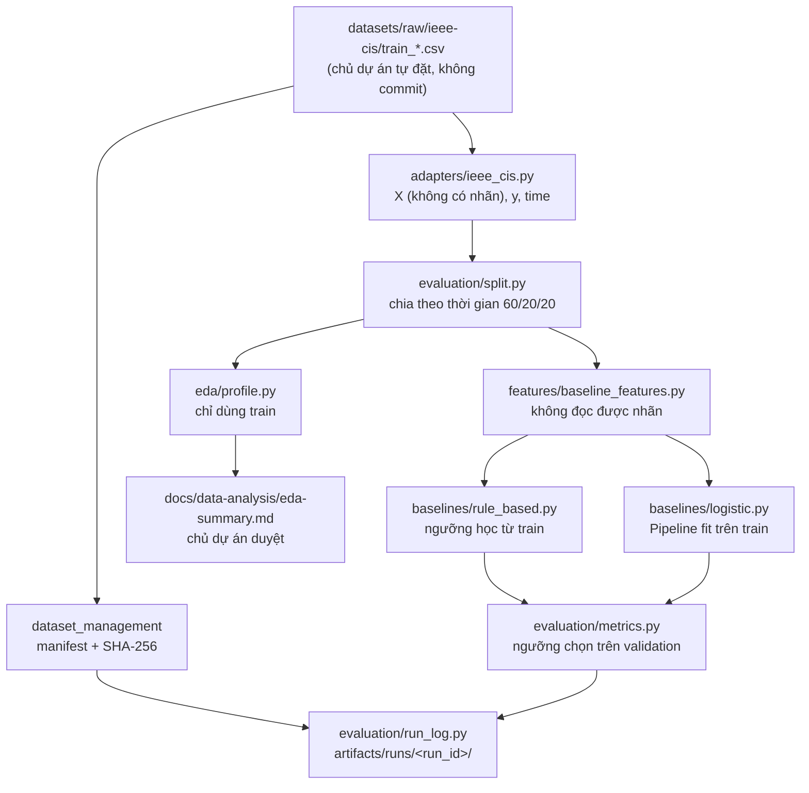

# Payment Intelligence Ecosystem


-orange)


Nền tảng dữ liệu và AI dạng module cho thanh toán, gồm một **nền tảng dùng chung** và hai sản phẩm độc lập: **Payment Reliability** và **Fraud & Risk**. Đây là bản demo 6 tuần cho báo cáo thực tập. Ưu tiên của dự án là **chất lượng đánh giá**: không rò rỉ dữ liệu, tái lập được, báo cáo trung thực. Điểm số mô hình là ưu tiên thứ yếu.

> Trạng thái hiện tại: đã xong **Stage A** (khung dự án) và **Stage B** (baseline phát hiện gian lận trên IEEE-CIS). Chưa có kết quả trên dữ liệu thật. Contract `payment-event` và các quyết định EDA đang chờ chủ dự án duyệt.
>
> **Về các nhánh:** `main` chỉ nhận code sau khi chủ dự án duyệt. Hiện `main` mới có T01; code T02–T10 nằm trên các nhánh `task/*` (xem bảng [Trạng thái dự án](#trạng-thái-dự-án)).

---

## Mục lục

1. [Giới thiệu](#giới-thiệu)
2. [Trạng thái dự án](#trạng-thái-dự-án)
3. [Kiến trúc](#kiến-trúc)
4. [Cấu trúc thư mục](#cấu-trúc-thư-mục)
5. [Yêu cầu hệ thống](#yêu-cầu-hệ-thống)
6. [Cài đặt](#cài-đặt)
7. [Dữ liệu](#dữ-liệu)
8. [Sử dụng](#sử-dụng)
9. [Phương pháp đánh giá](#phương-pháp-đánh-giá)
10. [Kết quả đầu ra](#kết-quả-đầu-ra)
11. [Kiểm thử](#kiểm-thử)
12. [Quy tắc dữ liệu và bảo mật](#quy-tắc-dữ-liệu-và-bảo-mật)
13. [Quy trình đóng góp](#quy-trình-đóng-góp)
14. [Lộ trình](#lộ-trình)
15. [Giấy phép](#giấy-phép)
16. [Tác giả](#tác-giả)

---

## Giới thiệu

| Thành phần | Thư mục | Nội dung |
| --- | --- | --- |
| Shared Foundation | `contracts/`, `shared/`, `datasets/` | Data contract, công cụ quản lý dataset (manifest, checksum), validation, hạ tầng chung |
| Product 01: Payment Reliability | `projects/payment-reliability/` | KPI, phát hiện bất thường, sự cố, API, dashboard (chưa bắt đầu) |
| Product 02: Fraud & Risk | `projects/fraud-risk/` | Đặc trưng, mô hình, đánh giá, chấm điểm rủi ro (Stage B đã xong) |

Điểm rủi ro chỉ dùng để **hỗ trợ quyết định**. Hệ thống không tự động chặn giao dịch.

## Trạng thái dự án

| Task | Nội dung | Trạng thái | Nhánh | Đã vào `main` |
| --- | --- | --- | --- | --- |
| T01 | Khung repo, tooling, Docker Compose (PostgreSQL 16) | Xong | `task/T01-skeleton` | Có |
| T02 | Contract `payment-event` (bản draft) | Xong, **chờ chủ dự án duyệt** | `task/T02-contract-draft` | Chưa |
| T03 | Công cụ manifest dataset (SHA-256) | Xong | `task/T03-dataset-manifest` | Chưa |
| T04 | Adapter IEEE-CIS | Xong (đã test trên fixture tổng hợp) | `task/T04-ieee-cis-adapter` | Chưa |
| T05 | Chia dữ liệu theo thời gian | Xong | `task/T05-time-split` | Chưa |
| T05b | EDA trên partition train | Xong, **chờ chủ dự án duyệt quyết định** | `task/T05b-eda-profiling` | Chưa |
| T06 | Metrics (PR-AUC, bootstrap CI, ...) | Xong | `task/T06-metrics` | Chưa |
| T07 | Baseline dựa trên luật | Xong | `task/T07-rule-based-baseline` | Chưa |
| T08 | Baseline Logistic Regression | Xong | `task/T08-logistic-baseline` | Chưa |
| T09 | Run log, CLI, quy tắc test-once | Xong | `task/T09-run-log-cli` | Chưa |
| T10 | Test chống rò rỉ dữ liệu | Xong | `task/T10-leakage-guards` | Chưa |

## Kiến trúc

Luồng dữ liệu của Stage B:



Quy ước package (xem [ADR 0001](docs/decisions/0001-package-layout.md)): tên thư mục giữ dấu gạch ngang (`projects/fraud-risk/`), còn code Python nằm trong package snake_case bên trong (`fraud_risk/`). Ví dụ: `from fraud_risk.evaluation.split import time_split`.

## Cấu trúc thư mục

```text
.
├── contracts/
│   ├── payment-event/        # schema draft, rules, examples, tests, CHANGELOG
│   └── risk-context/         # chỉ có README
├── shared/
│   ├── dataset-management/   # package dataset_management: manifest.py, cli.py
│   ├── data-validation/      # chỉ có README
│   ├── synthetic-generator/  # chỉ có README (Stage C)
│   └── common/               # chỉ có README
├── datasets/
│   ├── manifests/            # một YAML cho mỗi dataset
│   └── raw/                  # git-ignored
├── projects/
│   ├── payment-reliability/  # chỉ có README
│   └── fraud-risk/
│       ├── fraud_risk/       # adapters, features, eda, evaluation, baselines, scripts
│       ├── configs/          # baseline.yaml
│       └── tests/
├── infrastructure/           # docker/, database/
├── docs/                     # architecture, product, data-governance, data-analysis, decisions
├── tests/                    # test layout và .gitignore
├── artifacts/                # git-ignored: runs, EDA, Parquet
├── compose.yaml
├── Makefile
└── pyproject.toml
```

## Yêu cầu hệ thống

- Python **3.11+**
- [uv](https://docs.astral.sh/uv/) (khuyến nghị). Nếu không có uv, Makefile tự chuyển sang `venv` + `pip`.
- Docker và Docker Compose (để chạy PostgreSQL 16)
- `make`, `git`
- RAM khuyến nghị ≥ 8 GB khi chạy trên toàn bộ IEEE-CIS ([Ước đoán] khoảng 590 nghìn dòng × 394 cột)

## Cài đặt

```bash
git clone https://github.com/TrungTuyenDo02/Payment_Intelligence_Ecosystem.git
cd Payment_Intelligence_Ecosystem
```

```bash
cp .env.example .env
```

Đổi `POSTGRES_PASSWORD` trong `.env`. File `.env` không bao giờ được commit.

```bash
make setup
```

```bash
make lint test
```

```bash
make up
```

`make up` khởi động PostgreSQL 16 và chờ đến khi trạng thái là `healthy`. Dùng `make down` để dừng.

## Dữ liệu

Dự án dùng bộ **IEEE-CIS Fraud Detection** (Kaggle). Agent không bao giờ tự tải dữ liệu. Muốn tải, bạn cần đăng nhập Kaggle và chấp nhận điều khoản cuộc thi.

1. Đặt các file vào `datasets/raw/ieee-cis/`. Nếu để chỗ khác, đặt biến môi trường `IEEE_CIS_DIR`.

   ```text
   datasets/raw/ieee-cis/
     train_transaction.csv
     train_identity.csv
     test_transaction.csv   # KHÔNG có nhãn, không dùng để đánh giá
     test_identity.csv      # KHÔNG có nhãn
   ```

2. Tạo manifest (ghi checksum và nguồn gốc dữ liệu):

   ```bash
   PYTHONPATH=shared/dataset-management uv run python -m dataset_management.cli --name ieee-cis --source "Kaggle competition: IEEE-CIS Fraud Detection (https://www.kaggle.com/c/ieee-fraud-detection)" --base-dir datasets/raw/ieee-cis --file train_transaction.csv --file train_identity.csv --download-date YYYY-MM-DD --license-note "Kaggle competition terms, research use only, verify before any other use" --out datasets/manifests/ieee-cis.yaml
   ```

Lưu ý:
- Chỉ dùng các file `train_*`. Train, validation và test đều được tách từ chính các file này theo thời gian.
- Nếu file dữ liệu bị thay đổi sau khi tạo manifest, lần chạy sẽ dừng với lỗi `changed since the manifest`.
- Giấy phép: điều khoản cuộc thi Kaggle, chỉ dùng cho nghiên cứu. Cần kiểm tra lại trước khi dùng vào mục đích khác.

## Sử dụng

| Lệnh | Mục đích |
| --- | --- |
| `make setup` | Tạo môi trường và cài thư viện |
| `make lint` | `ruff check` và `ruff format --check` |
| `make test` | `pytest` kèm coverage |
| `make up` / `make down` | Bật / tắt PostgreSQL |
| `make eda` | Chạy EDA trên partition train, ghi bảng vào `artifacts/eda/` |
| `make baseline` | Chạy hai baseline, chỉ đánh giá trên train và validation |
| `make baseline-final` | Đánh giá trên test **một lần duy nhất** cho config đã `frozen` |

Quy trình chuẩn:

```bash
make eda
```

Đọc các bảng trong `artifacts/eda/`, sau đó chủ dự án duyệt từng dòng trong [`eda-summary.md`](docs/data-analysis/eda-summary.md).

```bash
make baseline
```

Bước này tạo thư mục `artifacts/runs/<run_id>/`. Khi đã chốt cấu hình, **chỉ chủ dự án** sửa `status: draft` thành `status: frozen` trong `projects/fraud-risk/configs/baseline.yaml`, rồi chạy:

```bash
make baseline-final
```

Dùng config khác bằng `make baseline CONFIG=path/to/config.yaml`.

## Phương pháp đánh giá

| Thành phần | Cách làm |
| --- | --- |
| Chia dữ liệu | Sắp theo `TransactionDT`: 60% đầu là train, 20% tiếp là validation, 20% cuối là test. Các dòng cùng timestamp luôn nằm chung một phần, và có kiểm tra không chồng lấn thời gian. Không chia ngẫu nhiên. |
| Tách nhãn | Adapter trả `X` (không có `isFraud`) riêng với `y`. Hàm tạo feature không có tham số `y`. |
| Fit | Mọi imputer, scaler, encoder và ngưỡng luật chỉ học trên **train**. Ngưỡng quyết định chọn trên **validation**. |
| Baseline 1 | Luật minh bạch: số tiền > q99 của train; `ProductCD` và `card6` có fraud rate cao (tính trên train). Điểm = tỷ lệ luật bị kích hoạt, nằm trong [0, 1]. |
| Baseline 2 | `Pipeline`: median impute + scale cho cột số, one-hot (`handle_unknown='ignore'`) cho cột phân loại, `LogisticRegression(class_weight='balanced')`. |
| Metrics | PR-AUC kèm bootstrap CI 95% (200 lần, có seed); precision, recall, F1, FPR tại ngưỡng; recall tại precision 0.5. **Không** báo accuracy, vì dữ liệu mất cân bằng lớp. |
| Định danh run | `run_id` là hash của: config (bỏ trường `status`), seed, checksum manifest, mốc split. Không gồm git SHA. |
| Test-once | `make baseline-final` từ chối config chưa `frozen` và config đã từng chạy test (ghi trong `artifacts/test_runs.json`). Có thể ép bằng `FORCE=1`, khi đó cảnh báo được ghi vào `metrics.json`. |

## Kết quả đầu ra

Mỗi run ghi vào `artifacts/runs/<run_id>/` (thư mục này bị git-ignore):

| File | Nội dung |
| --- | --- |
| `config.yaml` | Bản sao config đã dùng |
| `metrics.json` | Metrics theo model và partition (train/valid, thêm test ở bước final) |
| `split.json` | Mốc thời gian, số dòng và fraud rate của từng partition |
| `threshold.json` | Ngưỡng chọn trên validation, kèm phương pháp chọn |
| `models.json` | Luật với ngưỡng đã học; hệ số Logistic Regression (JSON, không dùng pickle) |
| `environment.txt` | Phiên bản Python và các thư viện |
| `git_sha.txt` | Commit đang chạy (có hậu tố `-dirty` nếu còn thay đổi chưa commit) |
| `manifest_checksum.txt` | Checksum của dataset |

Kết quả trên dữ liệu thật: **chưa có**. Bảng kết quả sẽ được bổ sung sau khi chủ dự án chạy trên máy cá nhân.

## Kiểm thử

```bash
make test
```

- Toàn bộ test chạy trên **dữ liệu tổng hợp** có cấu trúc giống IEEE-CIS. Repo không chứa dữ liệu thật.
- Test chống rò rỉ (`projects/fraud-risk/tests/test_leakage_guards.py`) sẽ fail nếu xảy ra một trong các trường hợp sau:
  - một cột suy ra từ nhãn lọt vào features;
  - baseline dùng split ngẫu nhiên;
  - một transformer hoặc ngưỡng được fit ngoài partition train.
- Test tái lập: chạy hai lần với cùng config, seed và dữ liệu phải cho `metrics.json` giống hệt từng byte.

## Quy tắc dữ liệu và bảo mật

- Không dùng dữ liệu thật của công ty. Không commit credentials, `.env`, dữ liệu, file Parquet hay file mô hình.
- Không có dữ liệu thẻ hoặc dữ liệu xác thực trong schema, fixture hay log.
- Không tải hay chạy mô hình pretrained từ internet (rủi ro nhiễm dữ liệu và rủi ro thực thi mã từ pickle).

## Quy trình đóng góp

- Mỗi task một nhánh `task/<ID>-<slug>`, chia thành các commit nhỏ.
- Một task chỉ được coi là xong khi `make lint` và `make test` đều pass.
- Contract chỉ được tạo dưới dạng draft. Muốn thay đổi kiến trúc, đề xuất bằng ADR trong `docs/decisions/`.
- Chỉ chủ dự án được: duyệt contract, duyệt quyết định EDA, đặt `frozen`, chạy `make baseline-final`.

## Lộ trình

| Stage | Nội dung |
| --- | --- |
| A, B | Khung dự án và baseline fraud (**đã xong**) |
| C | Synthetic generator và ingestion |
| D | dbt marts, KPI và bộ phát hiện bất thường |
| E | Thí nghiệm rò rỉ, Gradient Boosting, scoring API |
| F | Dashboard, tích hợp, báo cáo |

## Giấy phép

Mã nguồn phát hành theo giấy phép [MIT](LICENSE). Dữ liệu IEEE-CIS tuân theo điều khoản cuộc thi Kaggle và **không** được phân phối kèm repo.

## Tác giả

- **Đỗ Trung Tuyến** ([@TrungTuyenDo02](https://github.com/TrungTuyenDo02)): Technical Owner
