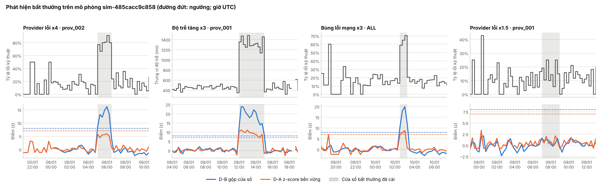

# Báo cáo Stage D — KPI độ tin cậy và phát hiện bất thường

- **Ngày:** 2026-11-04 (tuần 4 của lịch 6 tuần)
- **Đặc tả:** [`stage-d-spec.md`](stage-d-spec.md) (đã duyệt 2026-11-04), [ADR 0005](../decisions/0005-kpi-layer-sql-views.md) (SQL views).
- **Trạng thái:** D01–D05 xong. Detector đã chỉnh trên mô phỏng `tuning`. **Chưa đánh giá trên mô phỏng `report`**: chờ chủ dự án xem kết quả dưới đây, rồi đặt `status: frozen` cho `projects/payment-reliability/configs/detector.yaml` và chạy `make detect-report` một lần (quyết định Q6). Mục 2 sẽ được bổ sung sau lần chạy đó.

## 1. Đã làm gì

| Task | Nội dung | Kiểm chứng |
| --- | --- | --- |
| D01 | 5 SQL view trong `infrastructure/database/002_kpi_views.sql`: KPI theo khung 15 phút cho từng provider và `ALL`, lỗi theo mã, payment mới theo phương thức. Khung trống vẫn có dòng. `make db-init` chạy mọi file schema theo thứ tự số | Test tích hợp so view với một cách tính độc lập bằng pandas: mọi số đếm khớp, p50/p95 khớp, không thiếu khung nào |
| D02 | `make kpi SIM=...` ghi Parquet vào `artifacts/kpi/<simulation_id>/` | Hai lần xuất cho file giống hệt từng byte, kể cả sau khi nạp lại vào một database mới; báo lỗi rõ nếu chưa nạp mô phỏng |
| D03 | Hai detector: **D-A** z-score bền vững (trung vị, MAD của 24 giờ trước), **D-B** gộp cửa sổ (z-score nhị thức cho tỷ lệ, trung bình có trọng số của log độ trễ) | Test trên chuỗi tự tạo: bắt bước nhảy đã biết, yên lặng ở phần còn lại; với cùng mức thay đổi, ít attempt hơn thì điểm D-B thấp hơn; trường hợp mất lưu lượng khớp số tính tay (7,2) |
| D04 | Gộp các khung cảnh báo liền nhau (khoảng trống ≤ 1 khung) thành sự cố, theo từng detector và đối tượng | Test gộp và tách trên ví dụ tự tạo |
| D05 | Đánh giá với nhãn, `make detect`, `make tune`, `make detect-plot`, `make detect-report` | Khớp một ví dụ tính tay; detector không import module đọc nhãn (kiểm tra AST) và đổi nhãn không đổi cảnh báo; `detect` từ chối mô phỏng `report`; `detect-report` từ chối config `draft` và từ chối chạy lại cùng hash |

Toàn bộ `make test` với PostgreSQL 16: **345 test pass**, không test nào bị bỏ qua. Độ phủ của `payment_reliability`: `evaluation.py`, `incidents.py`, `kpi.py` 100%, `detectors.py` 98%, `plots.py` 96%, `cli.py` 65% (phần còn lại là hàm `main`).

## 2. Kết quả trên mô phỏng `tuning`

Lần chạy `det-3ddc26cff253` trên `sim-485cacc9c858` (7 ngày, 25.573 payment, 4 bất thường đã cài). Config `detector.yaml` ở trạng thái `draft`, ngưỡng chọn bằng `make tune`.

> Đây là số trên chính dữ liệu dùng để chỉnh ngưỡng, nên lạc quan hơn thực tế. Số dùng cho báo cáo thực tập là số trên mô phỏng `report`, chưa chạy.

### 2.1 Chọn tham số

`make tune` thử 9 ngưỡng cho D-A và 9 ngưỡng × 3 kích thước cửa sổ gộp (2, 4, 8 khung) cho D-B. Quy tắc chọn được viết trong code **trước khi chạy**:
1. bắt được nhiều bất thường nhất, đúng đối tượng;
2. với điều kiện báo nhầm không quá 1 sự cố mỗi ngày;
3. nếu hoà: độ trễ trung bình ngắn hơn, rồi đến ngưỡng cao hơn (thận trọng hơn).

| Detector | Tham số chọn | Bắt được | Báo nhầm / ngày | Độ trễ TB |
| --- | --- | --- | --- | --- |
| D-A z-score bền vững | ngưỡng 7 | 2/4 | 1,00 | 22,5 phút |
| D-B gộp cửa sổ | ngưỡng 8, gộp 2 khung (30 phút) | 3/4 | 0,00 | 15 phút |

**Có nhiều cấu hình D-B hoà nhau** (cùng bắt 3/4, không báo nhầm, độ trễ 15 phút) với ngưỡng 5 đến 8. Bộ tuning chỉ có 4 bất thường nên không đủ để phân biệt các cấu hình này. Quy tắc hoà chọn ngưỡng cao nhất.

### 2.2 Từng bất thường

| Bất thường | Đối tượng | D-A | D-B |
| --- | --- | --- | --- |
| `provider_outage` x4, 90 phút | `prov_002` | **Trượt** (điểm cao nhất 5,9 < 7) | Bắt, sau 15 phút |
| `latency_degradation` x3, 3 giờ | `prov_001` | Bắt, sau 15 phút | Bắt, sau 15 phút |
| `error_burst` x3, 45 phút | mọi provider | Bắt, sau 30 phút | Bắt, sau 15 phút |
| `provider_outage` **x1,5**, 2 giờ | `prov_001` | Trượt (điểm cao nhất 2,1) | Trượt (điểm cao nhất 1,6) |

### 2.3 Đọc kết quả

- **D-B tốt hơn D-A rõ rệt**, đúng lý do được thiết kế. Ngoài các cửa sổ bất thường, điểm D-A lên tới 10 vào ban đêm, khi một khung chỉ có vài attempt và một lỗi là thành tỷ lệ 50%. Muốn ít báo nhầm thì D-A phải đặt ngưỡng cao, và khi đó trượt cả sự cố x4. D-B tính đến số attempt nên điểm ban đêm nhỏ (cao nhất 4,6 ngoài các cửa sổ bất thường), cho phép ngưỡng 8 mà vẫn bắt nhanh.
- **Không detector nào bắt được sự cố yếu x1,5**, và kết quả này giải thích được bằng tính tay. Theo config, tỷ lệ lỗi kỹ thuật của `prov_001` sẽ tăng từ khoảng 10,5% lên khoảng 18%. Gộp cả 2 giờ (khoảng 130 attempt), mức tăng đó chỉ bằng khoảng 2,8 lần độ dao động ngẫu nhiên. Trong lần mô phỏng này, do ngẫu nhiên, tỷ lệ thực tế trong cửa sổ chỉ là 15,0% (21 lỗi trên 140 attempt) so với 10,5% ở 24 giờ trước, tức khoảng 1,7 lần độ dao động. Cả hai mức đều thấp hơn nhiều so với ngưỡng 8 cần để không báo nhầm. Với lượng dữ liệu này, sự cố x1,5 nằm dưới ngưỡng phát hiện được. Hạ ngưỡng cũng không giúp: ở ngưỡng 3 với cửa sổ 8 khung, cảnh báo duy nhất trùng thời điểm lại ở `prov_002` (sai đối tượng), trong khi báo nhầm lên 0,86 lần mỗi ngày.
- **2 sự cố "sai đối tượng" của D-B** là tiếng vọng ở `ALL`: khi `prov_002` hỏng, tỷ lệ lỗi tổng cũng tăng. Chúng không bị tính là báo nhầm vì xảy ra đúng lúc có sự cố. Dashboard ở Stage F nên gộp cảnh báo `ALL` với cảnh báo provider cùng lúc.
- **Độ trễ 15 phút là mức nhỏ nhất có thể**: cảnh báo chỉ được đưa ra khi khung 15 phút đầu tiên của sự cố kết thúc.

## 3. Lệch so với đặc tả

| Điểm | Đặc tả | Thực tế | Lý do |
| --- | --- | --- | --- |
| Chỉ số độ trễ cho detector | p50 hoặc p95 | Chỉ dùng p50 (trung vị); p95 có trong view nhưng không đưa vào detector | Với khoảng 12 attempt mỗi khung, p95 gần như là giá trị lớn nhất, rất nhiễu |
| Lệnh vẽ biểu đồ | Không nêu | Thêm `make detect-plot` | Cần cho task D06 |
| Code đánh giá trong CLI | Không nêu | `tune` và `detect` đều đọc nhãn, nhưng chỉ của mô phỏng `tuning` | Theo mục 7 của đặc tả: chỉ chỉnh trên `tuning` |

## 4. Hạn chế đã biết

- **Dữ liệu và bất thường đều do mình đặt.** Đây là kiểm chứng trên bất thường đã biết, không phải hiệu năng thực tế.
- **Bộ tuning nhỏ:** 4 bất thường. Số "3/4" có độ bất định rất lớn; nên đọc là danh sách từng trường hợp, không phải một tỷ lệ.
- **Giả định nhị thức của D-B** coi các attempt là độc lập. Retry của cùng một payment không hoàn toàn độc lập, nên điểm D-B có thể hơi cao hơn mức đúng.
- **Ngày đầu không có điểm:** detector cần ít nhất 12 giờ lịch sử, nên sự cố trong khoảng 12–24 giờ đầu của mô phỏng không thể bị phát hiện.
- **Một khung 15 phút là độ phân giải nhỏ nhất:** sự cố ngắn hơn 15 phút sẽ bị làm loãng.

## 5. Việc còn lại

| Việc | Ai | Ghi chú |
| --- | --- | --- |
| Xem kết quả mục 2, rồi đặt `status: frozen` cho `projects/payment-reliability/configs/detector.yaml` | Chủ dự án | Sau đó không chỉnh ngưỡng nữa |
| Chạy `make detect-report` một lần trên `sim-f6e6749ff0bf`, rồi `make detect-plot` cho lần chạy đó | Chủ dự án (hoặc agent nếu được yêu cầu rõ) | Bổ sung số vào mục 2 của báo cáo này |
| Thử `make up` và `make db-init` từ WSL | Chủ dự án | Kiểm chứng đến nay dùng PostgreSQL 16 tạm |
