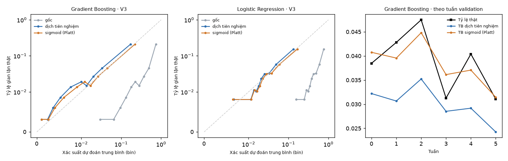
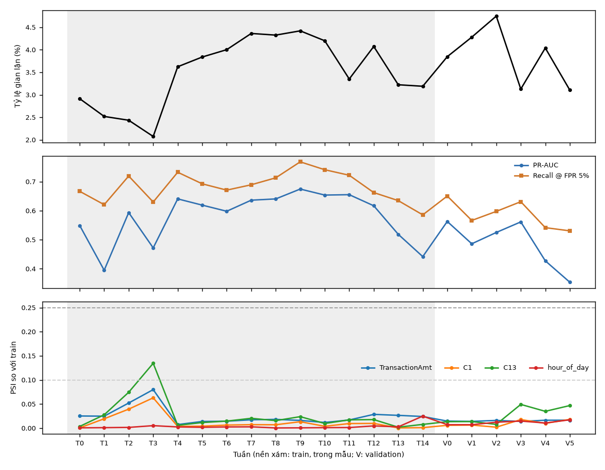

# Báo cáo Stage G — Từ xếp hạng đến quyết định (Product 02)

- **Đặc tả:** [stage-g-spec.md](stage-g-spec.md) (đã duyệt 2026-11-11), [ADR 0009](../decisions/0009-decision-evaluation-protocol.md).
- **Mọi kết quả ở đây là "thăm dò"**: chỉ dùng train + validation, mà validation đã bị dùng cho lưới GBM, thí nghiệm rò rỉ và đặc trưng lịch sử. Tập test **không** được nạp ở bước nào.
- Môi trường các lần chạy: Python 3.12.10, scikit-learn 1.9.1, pandas 3.1.0, numpy 2.5.4, Windows 11.

## Tóm tắt

| Phần | Câu hỏi | Quan sát (trong dữ liệu phát triển, thăm dò) | Mã lần chạy | Commit |
| --- | --- | --- | --- | --- |
| G02 | Đọc số Stage E thế nào? | Recall @ FPR 5% (0,51 trên test) chọn ngưỡng bằng nhãn test, nên chỉ đo chất lượng xếp hạng. Ngưỡng 0,853 chốt trước cho recall 0,371 tại FPR 1,24%: hai điểm vận hành khác nhau, không phải một mức sụt | `run-f8807cb6f780` (trích lại) | — |
| G03 | Điểm có đọc như xác suất được không? | Không: trung bình điểm GBM gấp khoảng 7 lần tỷ lệ gian lận thật. Dịch tiên nghiệm và Platt đều sửa được phần lớn (log loss V3 0,35 → 0,11); hai cách gần như ngang nhau; cả hai đi trễ so với trôi theo tuần | `cal-04b3ad5944ce` | `50d01de` |
| G04 | Dùng điểm ra quyết định thế nào? | Luật chi phí theo số tiền, dùng xác suất đã hiệu chỉnh, có chi phí thấp nhất ở 27/27 tổ hợp chi phí giả định và 4/4 cửa sổ cuốn chiếu; dùng điểm gốc thì luật này cảnh báo quá nhiều. Ngưỡng FPR 5% chọn trước cho FPR thực tế 3,9%–5,6% | `pol-af5df43efe54` | `fb53035` |
| G05 | Mô hình ổn định đến đâu? | PR-AUC theo tuần validation 0,35–0,56, thấp nhất ở hai tuần cuối; PSI của 4 đầu vào đều dưới 0,05 nên không giải thích được sự sụt giảm. `ProductCD = W` (79% giao dịch) có recall @ FPR 5% thấp nhất (0,39) | `stab-36887d48b356` | `ed54347` |
| G08 | Điểm được tạo ra theo lô thế nào? | `make score-model` rồi `make score` chấm một file CSV giao dịch (không có nhãn). Trên 2.000 dòng V3, điểm chấm theo lô trùng **đúng từng bit** với điểm lúc huấn luyện; tham số Platt trùng G03 | `score-19e94be9616d` | xem `HANDOFF.md` |

Kết quả nằm trong `artifacts/experiments/<mã>/` (`results.json`, `summary.md`, hình, `config.yaml`, `environment.txt`, `git_sha.txt`). Thư mục `artifacts/` không nằm trong git; chạy lại bằng `make calibration`, `make policy`, `make stability` (cần dataset IEEE-CIS, khoảng 30–50 giây mỗi lệnh). Mỗi lệnh đã chạy ba lần (hai lần trước commit, một lần sau commit) và cho `results.json` trùng từng byte.

Từ G07 (ADR 0010), bản chép các file tóm tắt nằm trong git ở [`results/<mã>/`](../../results/README.md), kèm `executions/exec-….json` của hai lần chạy lại sau khi thêm `execution_id`: một ở commit có thay đổi chưa commit (ghi `-dirty`), một ở commit sạch `b729ed7`. Hai bản ghi có cùng SHA-256 của `results.json`. Gói không chứa hình, dự đoán theo dòng hay dữ liệu.

### Kết quả này không chứng minh

1. **Không chứng minh hiệu quả khi vận hành.** Mọi số liệu ở trên là dữ liệu lịch sử của validation, không phải số đo trên hệ thống thật hay trên dữ liệu mới.
2. **Không phải ước lượng không thiên lệch.** Validation đã được dùng để chọn cấu hình GBM và cho nhiều thí nghiệm trước; V3 là một phần của validation đó. Tập test không được dùng lại (ADR 0009), nên Stage G không có con số "chưa thấy" nào.
3. **Không phải ROI.** Chi phí là giả định; kết luận G04 chỉ đúng trong vùng giả định đã quét (`loss_rate` 0,5–1; `c_review` 1–25; `c_friction` 0–10) và với giả định mất mát tỷ lệ với số tiền. Riêng "27/27" có phần **đúng theo cách xây dựng**: luật chi phí là quy tắc tối thiểu chi phí kỳ vọng, và được chấm bằng đúng hàm chi phí giả định đó, nên nếu xác suất được hiệu chỉnh tốt thì về lý thuyết nó phải thắng. Điều kết quả thực sự cho thấy hẹp hơn: hiệu chỉnh fit trên V1 vẫn đủ tốt trên V3, và xét số tiền từng giao dịch có lợi hơn một ngưỡng điểm chung, **dưới hàm chi phí giả định**. Nó không cho biết luật này có tốt hơn khi mất mát thật khác giả định hay không.
4. **Không chứng minh nguyên nhân** của trôi theo tuần (G05) hay của việc PR-AUC khác nhau giữa các khối.
5. Giả định nhãn đến ngay (D3) làm mọi kết quả cần nhãn mới (hiệu chỉnh, chọn ngưỡng) lạc quan hơn thực tế.

### Ghi chú quy trình

- Ba config được viết trước lần chạy đầu tiên và không sửa sau khi thấy số V3. Tuy nhiên chúng được **commit sau** lần chạy đầu (cùng commit với code), không phải trước như đặc tả mục 5 yêu cầu. Lần chạy sau commit cho kết quả trùng từng byte với lần đầu.
- Thêm cờ `monotone` cho bộ hiệu chỉnh Platt (phương pháp có hệ số dốc ≤ 0 không bao giờ được chọn): phát hiện khi chạy test trên dữ liệu tổng hợp nhỏ, trước khi chạy dữ liệu thật. Trên dữ liệu thật, Platt fit trên V1 có hệ số dốc dương (GBM 1,097; LR 1,124); tham số Platt của từng cửa sổ cuốn chiếu không được lưu, chỉ lưu phương pháp được chọn.
- Đặc tả ghi tuần validation W0–W5 tính từ giao dịch đầu tiên của validation; mã làm đúng như vậy, nên tuần không trùng ranh giới ngày và không trùng ranh giới khối (W1 và W3 nằm vắt qua hai khối).

## Khối validation (chung cho G03–G05)

| Khối | Vai trò | Ngày | Dòng | Gian lận | Tỷ lệ |
| --- | --- | --- | --- | --- | --- |
| V1 | Hiệu chỉnh | 101–113 | 38.426 | 1.523 | 3,96% |
| V2 | Chọn | 114–126 | 41.426 | 1.741 | 4,20% |
| V3 | Đánh giá | 127–141 | 38.256 | 1.347 | 3,52% |

Mô hình cố định (không quét lại lưới) tái tạo đúng Stage E: PR-AUC validation GBM 0,4970, Logistic Regression 0,2454 (Stage E: 0,497 và 0,245).

## G03 — Hiệu chỉnh xác suất (`cal-04b3ad5944ce`)

Lệnh: `make calibration`. Config: [`calibration.yaml`](../../projects/fraud-risk/configs/calibration.yaml) (`draft`). Kết quả đầy đủ trong `artifacts/experiments/cal-04b3ad5944ce/summary.md`.

**Câu hỏi.** Hai mô hình học với `class_weight="balanced"`, tức là coi gian lận nặng gấp khoảng 28 lần giao dịch thường. Điểm số vì vậy không đọc được như xác suất. Điều này không ảnh hưởng chuyện xếp hạng, nhưng quan trọng khi đặt ngưỡng theo chi phí (G04): ở đó cần "xác suất giao dịch này là gian lận".

**Ba cách** (bộ hiệu chỉnh chỉ fit trên V1, chọn trên V2 theo log loss, báo trên V3):

- **Gốc:** dùng điểm như cũ.
- **Dịch tiên nghiệm:** cộng `log(π / (1 − π))` vào logit, với π = 3,38% là tỷ lệ gian lận của train. Cách này hoàn tác đúng trọng số cân bằng nếu mô hình đúng dạng, và không cần nhãn mới.
- **Sigmoid (Platt):** hồi quy logistic trên logit của điểm, fit bằng nhãn V1.

| Mô hình | Phương pháp | Brier V2 | Log loss V2 | Brier V3 | Log loss V3 | Xác suất TB V3 | Tỷ lệ thật V3 |
| --- | --- | --- | --- | --- | --- | --- | --- |
| GBM | Gốc | 0,1095 | 0,3632 | 0,1037 | 0,3511 | 0,2610 | 0,0352 |
| GBM | Dịch tiên nghiệm | 0,0259 | 0,1082 | 0,0259 | 0,1095 | 0,0270 | 0,0352 |
| GBM | **Sigmoid (Platt)** ← chọn | 0,0253 | 0,1063 | 0,0256 | 0,1085 | 0,0346 | 0,0352 |
| LR | Gốc | 0,1910 | 0,5702 | 0,1816 | 0,5511 | 0,3989 | 0,0352 |
| LR | Dịch tiên nghiệm | 0,0344 | 0,1408 | 0,0307 | 0,1301 | 0,0326 | 0,0352 |
| LR | **Sigmoid (Platt)** ← chọn | 0,0341 | 0,1396 | 0,0309 | 0,1302 | 0,0381 | 0,0352 |



**Kết luận** (trong dữ liệu phát triển, thăm dò):

1. **Điểm gốc không phải xác suất.** Trung bình điểm GBM là 0,26 trong khi tỷ lệ gian lận thật là 0,035, tức là gấp khoảng 7 lần. Log loss gốc (0,35) tệ hơn cả cách đoán hằng số bằng tỷ lệ gian lận (khoảng 0,15 khi tỷ lệ 3,5%).
2. **Hiệu chỉnh nào cũng sửa được phần lớn sai lệch.** Log loss giảm từ khoảng 0,35 xuống 0,11 (GBM). Riêng dịch tiên nghiệm không dùng nhãn validation nào mà đã đạt gần mức của Platt.
3. **Platt và dịch tiên nghiệm gần như ngang nhau.** Trên V3, log loss của GBM chênh 0,001 và của LR chênh 0,0001. Platt được chọn trên V2 cho cả hai mô hình, nhưng trong 4 cửa sổ cuốn chiếu, dịch tiên nghiệm được chọn 1/4 lần với GBM và 2/4 lần với LR. Không nên đọc đây là "Platt tốt hơn".
4. **Hiệu chỉnh không theo kịp trôi theo tuần.** Tỷ lệ gian lận thật dao động 3,1%–4,75% giữa các tuần validation, còn xác suất trung bình sau hiệu chỉnh thì gần như phẳng (Platt: 3,1%–4,5%) và đi trễ so với tỷ lệ thật. Bộ hiệu chỉnh fit một lần trên V1 không thể biết tỷ lệ của tuần sau.
5. **PR-AUC không đổi**, đúng như kỳ vọng: ở mọi khối, ba phương pháp cho cùng PR-AUC, vì chúng chỉ đổi giá trị chứ không đổi thứ tự điểm. Các chính sách top-N ở G04 cũng không đổi theo hiệu chỉnh.

Ngoài lề: PR-AUC của GBM thay đổi đáng kể giữa các khối (V1 0,514; V2 0,555; V3 0,404) với cùng một mô hình. Điều này nhắc rằng một con số PR-AUC trên một giai đoạn có độ biến thiên lớn; G05 đo kỹ hơn.

**Tự kiểm tra**

| Kiểm tra | Kết quả |
| --- | --- |
| Không chạm test | Test tự động: đảo nhãn và đổi đặc trưng của mọi dòng test không đổi một giá trị nào của kết quả |
| Đảo nhãn | Hoán vị nhãn V3: PR-AUC GBM 0,0355, bằng tỷ lệ gian lận V3 0,0352 (mức ngẫu nhiên) |
| Nhìn tương lai | Test: đảo nhãn V3 không đổi tham số bộ hiệu chỉnh và phương pháp được chọn |
| Phá hoại có chủ đích | Tạm bỏ kiểm tra vai trò khối: test "fit trên V3" thất bại. Tạm cho dòng test vào dữ liệu phát triển: 2 test thất bại. Đã khôi phục code |
| Tính độc lập | Brier và log loss của GBM + Platt trên 1.000 dòng đầu V3, tính bằng vòng lặp Python thuần: 0,0208137948 và 0,0855486315, trùng code chính đến 10 chữ số |
| Tái lập | Chạy `make calibration` hai lần: cùng `cal-04b3ad5944ce`, `results.json` trùng từng byte |

**Hạn chế (kết quả này không chứng minh):**

- Không chứng minh hiệu chỉnh sẽ đúng trên dữ liệu sau validation. Tỷ lệ gian lận trôi theo tuần, và bộ hiệu chỉnh tĩnh đi trễ.
- Bộ hiệu chỉnh fit trên V1 rồi áp ngay lên V2/V3, tức là giả định nhãn V1 có ngay. Thực tế chargeback đến muộn (D3, hạn chế lạc quan).
- Chênh lệch giữa Platt và dịch tiên nghiệm nhỏ hơn mức dao động giữa các cửa sổ, và chưa có khoảng tin cậy cho phần chênh này (không nằm trong danh sách đăng ký trước).
- Isotonic không được thử (D5).

## G04 — So sánh chính sách (`pol-af5df43efe54`)

Lệnh: `make policy`. Config: [`policy.yaml`](../../projects/fraud-risk/configs/policy.yaml) (`draft`). Mô hình: GBM cố định. Mọi lựa chọn (ngưỡng, phương pháp hiệu chỉnh) ra trên V1/V2 trước, rồi mới áp lên V3. Bảng đầy đủ 27 tổ hợp chi phí × 9 chính sách nằm trong `artifacts/experiments/pol-af5df43efe54/summary.md`.

**Đây là phân tích độ nhạy, không phải ROI.** Chi phí là giả định, tính theo đơn vị tương đối của `TransactionAmt`: bỏ sót một gian lận mất `loss_rate × số tiền`; mỗi cảnh báo tốn `c_review`; mỗi cảnh báo nhầm tốn thêm `c_friction`. Ký hiệu `L0.75/R5/F1` nghĩa là `loss_rate` 0,75, `c_review` 5, `c_friction` 1.

**Chín chính sách**

| Chính sách | Chọn trên | Quyết định |
| --- | --- | --- |
| Không cảnh báo | — | Mốc tham chiếu: bỏ sót mọi gian lận |
| max F1 (mốc) | V2 | Điểm ≥ 0,8527 (cùng quy tắc Stage E, chọn lại trên V2) |
| Ngưỡng chi phí V2 | V2 | Một ngưỡng điểm cho tổng chi phí trên V2 nhỏ nhất, riêng cho từng tổ hợp |
| Luật chi phí, điểm gốc | — | Cảnh báo nếu `s × loss_rate × số tiền > c_review + (1 − s) × c_friction`, đọc điểm gốc `s` như xác suất |
| Luật chi phí, đã hiệu chỉnh | V1 + V2 | Cùng luật, dùng xác suất đã hiệu chỉnh (Platt, chọn như G03) |
| top 0,5% / 1% / 2% / 5% | — | Mỗi ngày đưa N% giao dịch có điểm cao nhất đi duyệt |

**Phép thử chuyển ngưỡng.** Ngưỡng cho FPR 5% chọn trên V2 rồi áp lên V3:

| Chọn → áp | Ngưỡng | FPR thực tế | Recall thực tế | Recall @ FPR 5% chọn bằng nhãn của chính tập |
| --- | --- | --- | --- | --- |
| V2 → V3 | 0,6726 | 4,27% | 0,513 | 0,539 |
| R1: W1 → W2 | 0,6689 | **5,63%** | 0,607 | 0,598 |
| R2: W2 → W3 | 0,6900 | 3,88% | 0,598 | 0,631 |
| R3: W3 → W4 | 0,6557 | 4,84% | 0,531 | 0,542 |
| R4: W4 → W5 | 0,6508 | 4,61% | 0,523 | 0,531 |

Ngưỡng chọn trước cho FPR thực tế từ 3,9% đến 5,6%, tức là có lúc vượt mục tiêu 5%. Recall thấp hơn con số chọn ngưỡng bằng nhãn của chính tập ở 4/5 trường hợp, chênh tới 0,033. Con số "recall @ FPR 5%" trong các bảng chất lượng xếp hạng vì vậy là mức tham chiếu lạc quan (xem G02).

**V3, các chính sách không phụ thuộc chi phí** (38.256 giao dịch, 1.347 gian lận, tổng tiền gian lận 221.292):

| Chính sách | Cảnh báo | Gian lận bắt | Báo nhầm | Recall | Tiền gian lận bắt | Tỷ lệ tiền bắt | FPR |
| --- | --- | --- | --- | --- | --- | --- | --- |
| max F1 (mốc) | 871 | 488 | 383 | 0,362 | 71.591 | 0,324 | 1,04% |
| top 0,5% | 200 | 154 | 46 | 0,114 | 7.918 | 0,036 | 0,12% |
| top 1% | 392 | 278 | 114 | 0,206 | 30.361 | 0,137 | 0,31% |
| top 2% | 772 | 437 | 335 | 0,324 | 64.215 | 0,290 | 0,91% |
| top 5% | 1.921 | 645 | 1.276 | 0,479 | 110.132 | 0,498 | 3,46% |

**V3 tại tổ hợp giữa lưới `L0.75/R5/F1`.** Khoảng tin cậy 95% bootstrap theo ngày; cột cuối theo cụm `card1`.

| Chính sách | Cảnh báo | Gian lận bắt | Tiền bắt | Tổng chi phí [CI ngày] | Chênh so với max F1 [CI ngày] | CI chênh (`card1`) |
| --- | --- | --- | --- | --- | --- | --- |
| Không cảnh báo | 0 | 0 | 0 | 165.969 [135.050; 197.754] | +48.955 [34.262; 65.239] | [23.948; 85.783] |
| max F1 (mốc) | 871 | 488 | 71.591 | 117.013 [95.977; 138.289] | 0 | — |
| top 2% | 772 | 437 | 64.215 | 122.003 [99.362; 144.425] | +4.989 [84; 10.679] | [872; 10.048] |
| top 5% | 1.921 | 645 | 110.132 | 94.251 [76.500; 112.299] | −22.763 [−31.353; −14.682] | [−36.954; −11.483] |
| Ngưỡng chi phí V2 | 3.598 | 798 | 142.147 | 80.148 [64.551; 97.009] | −36.865 [−46.669; −27.340] | [−58.612; −19.323] |
| Luật chi phí, điểm gốc | 24.814 | 1.227 | 217.256 | 150.684 [129.743; 167.324] | +33.670 [14.835; 53.013] | [7.338; 59.182] |
| **Luật chi phí, đã hiệu chỉnh** | 4.325 | 762 | 173.245 | **61.223** [52.621; 69.471] | **−55.790** [−72.113; −39.916] | [−80.188; −35.149] |

**Kết luận** (trong dữ liệu phát triển, dưới các giả định chi phí ở trên, thăm dò):

1. **Luật chi phí dùng xác suất đã hiệu chỉnh có tổng chi phí thấp nhất ở cả 27/27 tổ hợp chi phí trên V3, và ở cả 4 cửa sổ cuốn chiếu.** Khoảng tin cậy của phần chênh so với max F1 nằm hoàn toàn dưới 0, cả khi lấy mẫu theo ngày lẫn theo cụm `card1`. Ở tổ hợp giữa lưới, nó bắt ít giao dịch gian lận hơn ngưỡng chi phí V2 (762 so với 798) nhưng bắt được nhiều **tiền** hơn (173 nghìn so với 142 nghìn), vì luật xét số tiền của từng giao dịch: nó ưu tiên giao dịch lớn, còn một ngưỡng điểm thì không.
2. **Hiệu chỉnh là điều kiện cần cho luật này.** Cùng công thức nhưng đọc điểm gốc như xác suất thì cảnh báo quá nhiều (24.814 so với 4.325 ở tổ hợp giữa), và đắt hơn cả max F1 ở tổ hợp này. Điểm gốc bị thổi lên khoảng 7 lần (G03), nên luật tưởng gian lận phổ biến hơn thực tế. Ngược lại, hiệu chỉnh **không** đổi chính sách dùng một ngưỡng điểm: ngưỡng chi phí chọn trên điểm đã hiệu chỉnh cho đúng cùng cảnh báo trên V3 ở mọi tổ hợp (đã kiểm tra).
3. **Ngưỡng max F1 không gắn với chi phí.** Nó luôn cảnh báo 871 giao dịch, bất kể cảnh báo rẻ hay đắt. Ngưỡng chi phí chọn trên V2 rẻ hơn max F1 ở tổ hợp giữa, nhưng số cảnh báo thay đổi rất mạnh theo giả định (từ 782 ở `L0.5/R25/F10` đến 28.792 ở `L1/R1/F0`).
4. **Ngân sách top-N** dễ vận hành (số cảnh báo mỗi ngày cố định), nhưng chỉ tốt khi N khớp với giả định chi phí: top 5% rẻ hơn max F1 ở tổ hợp giữa, top 2% hơi đắt hơn. Không có N nào tốt nhất ở mọi tổ hợp.
5. Ở tổ hợp góc `L1/R1/F0` (duyệt rẻ, mất trọn số tiền, không tính phiền khách), ba chính sách theo chi phí cảnh báo 43–96% giao dịch V3 (16.416 / 28.792 / 36.765). Khi duyệt gần như miễn phí thì cứ duyệt hết; góc lưới này ít thực tế.

**Tự kiểm tra**

| Kiểm tra | Kết quả |
| --- | --- |
| Không chạm test | Test tự động: đảo nhãn và đổi số tiền của mọi dòng test không đổi kết quả |
| Đảo nhãn | Hoán vị nhãn V3 (`L0.75/R5/F1`, ngưỡng chi phí V2): recall 0,084, xấp xỉ tỷ lệ cảnh báo 0,094, tức là không hơn chọn ngẫu nhiên |
| Nhìn tương lai | Test: đảo nhãn V3 không đổi ngưỡng hay phương pháp hiệu chỉnh đã chọn; đổi điểm của các ngày sau không đổi cảnh báo top-N của ngày trước |
| Phá hoại có chủ đích | Tạm bỏ kiểm tra vai trò khối ở bước chọn ngưỡng: test "chọn trên V3" thất bại. Đã khôi phục |
| Tính độc lập | Chi phí trên 1.000 dòng đầu V3 tính bằng vòng lặp thuần: max F1 1.506,925250, luật đã hiệu chỉnh 1.248,550250, trùng code chính. Thêm test tự động: ngưỡng chi phí bằng kết quả vét cạn mọi điểm cắt |
| Tái lập | Chạy `make policy` hai lần: cùng `pol-af5df43efe54`, `results.json` trùng từng byte |

**Hạn chế (kết quả này không chứng minh):**

- Không chứng minh chính sách nào sẽ tiết kiệm được bao nhiêu khi vận hành. Chi phí là giả định, không có dữ liệu chi phí thật, `TransactionAmt` không rõ đơn vị tiền tệ.
- Luật chi phí cần nhãn và số tiền đáng tin. Nếu mất mát thật không tỷ lệ với số tiền (ví dụ có bảo hiểm, có thu hồi), lợi thế "ưu tiên giao dịch lớn" có thể mất.
- Khoảng tin cậy chỉ có cho phần chênh so với max F1 (đã đăng ký trước). Phần chênh giữa luật đã hiệu chỉnh và ngưỡng chi phí V2 (khoảng −18,9 nghìn ở tổ hợp giữa) chưa có khoảng tin cậy riêng.
- V3 chỉ có 15 ngày, nên bootstrap theo ngày có ít khối. Khoảng theo `card1` rộng hơn, nhưng `card1` không phải định danh khách hàng chắc chắn.
- Giả định nhãn đến ngay (D3) và validation đã dùng nhiều lần: kết quả có thể lạc quan.
- Chính sách không xét năng lực duyệt thật (số người, giờ làm việc), trừ các ngân sách top-N.

## G05 — Độ ổn định theo thời gian và nhóm (`stab-36887d48b356`)

Lệnh: `make stability`. Config: [`stability.yaml`](../../projects/fraud-risk/configs/stability.yaml) (`draft`). Mô hình: GBM cố định. Không dùng tuần nào của tập test. Tuần validation tính từ giao dịch đầu tiên của validation nên không trùng ranh giới ngày; ví dụ W0 là ngày 101–108. Tuần train là dữ liệu mô hình đã học (trong mẫu), chỉ để mô tả.



**Theo tuần validation**

| Tuần | Khối | Dòng | Gian lận | Tỷ lệ | PR-AUC | Recall @ FPR 5% | PSI `TransactionAmt` | PSI `C1` | PSI `C13` | PSI `hour_of_day` |
| --- | --- | --- | --- | --- | --- | --- | --- | --- | --- | --- |
| W0 | V1 | 20.747 | 798 | 3,85% | 0,563 | 0,650 | 0,015 | 0,006 | 0,013 | 0,007 |
| W1 | V1/V2 | 20.957 | 897 | 4,28% | 0,486 | 0,566 | 0,014 | 0,006 | 0,014 | 0,007 |
| W2 | V2 | 22.137 | 1.051 | 4,75% | 0,525 | 0,598 | 0,016 | 0,002 | 0,008 | 0,012 |
| W3 | V2/V3 | 22.351 | 699 | 3,13% | 0,561 | 0,631 | 0,014 | 0,018 | 0,049 | 0,015 |
| W4 | V3 | 18.743 | 757 | 4,04% | 0,427 | 0,542 | 0,016 | 0,010 | 0,035 | 0,011 |
| W5 | V3 | 13.173 | 409 | 3,10% | 0,354 | 0,531 | 0,017 | 0,018 | 0,047 | 0,017 |

Tuần train: tỷ lệ gian lận 2,07%–4,42%; PR-AUC trong mẫu 0,395–0,674. PSI cao nhất là `C13` ở tuần train T3 (0,134), giai đoạn 4 tuần đầu có tỷ lệ gian lận thấp (2,1%–2,9%).

**Theo nhóm trên validation** (toàn bộ validation: PR-AUC 0,497, recall @ FPR 5% là 0,588)

| Cột | Giá trị | Dòng | Gian lận | Tỷ lệ | PR-AUC | Recall @ FPR 5% |
| --- | --- | --- | --- | --- | --- | --- |
| `ProductCD` | C | 15.329 | 1.979 | 12,91% | 0,715 | 0,699 |
| `ProductCD` | H | 3.079 | 244 | 7,92% | 0,631 | 0,627 |
| `ProductCD` | R | 4.021 | 260 | 6,47% | 0,748 | 0,731 |
| `ProductCD` | S | 1.813 | 124 | 6,84% | 0,548 | 0,516 |
| `ProductCD` | W | 93.866 | 2.004 | 2,13% | 0,172 | 0,390 |
| `card6` | credit | 25.914 | 2.174 | 8,39% | 0,619 | 0,609 |
| `card6` | debit | 92.180 | 2.437 | 2,64% | 0,380 | 0,512 |
| `card6` | thiếu / charge card / debit or credit | 4 / 3 / 7 | 0 | — | — | — (**cỡ mẫu nhỏ, không kết luận**) |

Tỷ lệ thiếu: chỉ `card4` và `card6` có giá trị thiếu trong dữ liệu phát triển. Tuần train T12 thiếu 3,6%; mọi tuần khác dưới 0,05%.

**Kết luận** (trong dữ liệu phát triển, thăm dò):

1. **Hiệu năng thay đổi nhiều theo tuần dù mô hình không đổi.** PR-AUC theo tuần validation dao động 0,354–0,563, recall @ FPR 5% dao động 0,531–0,650, và hai tuần cuối (V3) thấp nhất. Một con số PR-AUC gộp cho cả giai đoạn (0,497) che mất độ dao động này.
2. **PSI của bốn đầu vào đã chọn không giải thích được sự sụt giảm.** Mọi PSI validation đều dưới 0,05, thấp hơn ngưỡng quen thuộc 0,1, trong khi PR-AUC giảm. Theo dõi PSI của vài cột đầu vào vì vậy không thay được việc đo hiệu năng khi có nhãn. Có thể trôi nằm ở quan hệ giữa đặc trưng và nhãn, hoặc ở các cột không đo (trong 20 đặc trưng, PSI chỉ tính cho 4).
3. **Ngay cả trong mẫu, PR-AUC hai tuần train cuối cũng thấp** (0,519 và 0,442, so với 0,60–0,67 ở giữa train). Tức là giai đoạn cuối train và đầu validation khó hơn ngay cả với dữ liệu mô hình đã học; sụt giảm không chỉ do "dữ liệu mới".
4. **Theo nhóm:** `ProductCD = W` chiếm 79% giao dịch validation và 43% gian lận, nhưng có recall @ FPR 5% thấp nhất (0,390, so với 0,63–0,73 ở C, H, R). Không so PR-AUC giữa các nhóm, vì PR-AUC phụ thuộc tỷ lệ gian lận (2,1% ở W so với 12,9% ở C); recall @ FPR 5% so được hơn. Ba giá trị `card6` hiếm (14 dòng, 0 gian lận) không đủ để kết luận gì.

**Tự kiểm tra**

| Kiểm tra | Kết quả |
| --- | --- |
| Không chạm test | Test tự động: đổi nhãn, số tiền, `C1`, `C13`, `ProductCD` của mọi dòng test không đổi kết quả. Tổng dòng theo tuần bằng đúng số dòng train và validation |
| Đảo nhãn | Hoán vị nhãn validation: PR-AUC 0,0393, bằng tỷ lệ gian lận 0,0390 |
| Tính độc lập | Test: PSI so với tính tay trên một phân phối biết trước; PSI = 0 khi hai phân phối giống nhau |
| Cỡ mẫu nhỏ | Test: mọi nhóm dưới 30 gian lận được đánh dấu |
| Tái lập | Chạy `make stability` hai lần: cùng `stab-36887d48b356`, `results.json` trùng từng byte |

**Hạn chế (kết quả này không chứng minh):**

- Không chứng minh nguyên nhân của sự sụt giảm theo tuần; bảng chỉ cho thấy nó có, và PSI của 4 cột không đi kèm nó.
- Tuần có 400–1.050 gian lận nên PR-AUC từng tuần có sai số đáng kể; chưa có khoảng tin cậy theo tuần (không nằm trong danh sách đăng ký trước).
- Tuần train là trong mẫu, nên không so trực tiếp với tuần validation được.
- Nhóm chỉ xét theo hai cột; các nhóm giao nhau (ví dụ W × debit) chưa xét.

## G08 — Bộ chấm điểm theo lô (`score-19e94be9616d`)

Mục tiêu: biến Product 02 từ "bảng số đánh giá" thành thứ chạy được, nhận một bảng giao dịch và trả điểm, mà **không** mở tập test và không làm API (ngoài phạm vi).

```bash
make score-model                      # fit GBM trên train, Platt trên V1, lưu artifacts/models/score-<mã>/
make score                            # chấm mẫu 2.000 dòng V3 không nhãn (sample_v3.csv)
make score INPUT=<file.csv>           # chấm file khác cùng định dạng train_transaction.csv, không có cột isFraud
```

Đầu ra `artifacts/scores/<execution_id>.csv`: `TransactionID`, `score` (điểm gốc của GBM), `score_calibrated` (Platt fit trên V1), `model_version` (`score-<mã>`, cùng cách tính hash như các experiment Stage G, nên không đổi khi nâng thư viện), `feature_version` (`feat-v<FEATURES_VERSION>-<hash danh sách đặc trưng>`), `execution_id` (mỗi lần chấm một mã, ADR 0010). File `.json` cùng tên ghi SHA-256 của đầu vào, commit, và kết quả kiểm tra lệch huấn luyện–chấm điểm.

**Thiết kế và lý do**

- **Cùng một đường code.** Mô hình là đúng đối tượng `GbmModel` mà `prepare()` của Stage G đã fit và đã kiểm tra tái tạo PR-AUC validation 0,497. Đầu vào được đọc bằng cùng hàm đọc CSV và cùng kiểu dữ liệu như lúc huấn luyện (`read_transactions`), và đặc trưng được tạo bằng cùng `build_features`. Không có bản sao thứ hai của logic đặc trưng nên không có chỗ để lệch.
- **Chỉ đặc trưng theo dòng.** Cấu hình `gbm.yaml` chỉ dùng cột của chính dòng đó (`log_amount`, `hour_of_day`, `C1–C14`, …). Đặc trưng lịch sử thực thể (ADR 0008) cần các giao dịch trước đó của cùng thẻ, mà một lô không mang theo, nên bộ chấm điểm **từ chối** config có đặc trưng lịch sử thay vì chấm sai một cách im lặng.
- **Bộ chặn:** đầu vào có cột `isFraud` thì báo lỗi; có dòng sau `TransactionDT` 12.192.842 (thuộc giai đoạn test) thì báo lỗi; `TransactionID` trùng hoặc thiếu thì báo lỗi; Platt có hệ số dốc ≤ 0 thì báo lỗi.
- **Hiệu chỉnh cố định từ G03** (`platt`, được chọn trên V2 trong `cal-04b3ad5944ce`), fit lại trên V1 qua `fit_calibrator`, hàm này từ chối mọi khối không có vai trò `calibrate`.

**Kết quả trên dữ liệu thật** (thăm dò, chỉ dữ liệu phát triển)

| Kiểm tra | Kết quả |
| --- | --- |
| Lệch huấn luyện–chấm điểm | 2.000 dòng V3 đọc lại từ CSV: chênh tuyệt đối lớn nhất giữa điểm theo lô và điểm lúc huấn luyện là **0** |
| Tham số Platt | slope 1,0971, intercept −3,0314: trùng từng chữ số với `cal-04b3ad5944ce` |
| Tính độc lập | Tính lại `score_calibrated` bằng công thức Platt viết tay trên 1.000 dòng: chênh 0 |
| Tái lập | `make score-model` hai lần: cùng `score-19e94be9616d`; `dev_scores.csv`, `sample_v3.csv`, `model_card.json` trùng từng byte; hai bản ghi `executions/exec-….json` |
| Trung bình điểm trên mẫu | gốc 0,273; đã hiệu chỉnh 0,037 (cùng hướng với G03: điểm gốc bị thổi lên do `class_weight="balanced"`) |

**Test tự động** (`tests/test_stage_g_scoring.py`, dữ liệu tổng hợp): điểm theo lô bằng điểm huấn luyện trên cùng dòng; đổi thứ tự hoặc cỡ lô không đổi điểm; đổi các dòng sau thời điểm t không đổi điểm các dòng trước t; có nhãn, có dòng giai đoạn test, ID trùng, đặc trưng lịch sử đều bị từ chối; đảo nhãn V2/V3 không đổi bộ hiệu chỉnh, còn đảo nhãn V1 (phá hoại) làm hệ số dốc âm và bị từ chối. **Phá hoại có chủ đích:** tạm dịch `hour_of_day` thêm 7 giờ ở bước chấm điểm, như một lỗi lệch múi giờ, thì cả test so khớp lẫn bước kiểm tra lệch của CLI đều thất bại; đã khôi phục.

**Hạn chế (kết quả này không chứng minh):**

- Không phải hệ thống chấm điểm vận hành: không có API, không xử lý dòng đến theo thời gian thực, không giám sát.
- Kiểm tra lệch chỉ so được trên dòng đã có điểm lúc huấn luyện (validation). Với dữ liệu thật mới, nó chỉ bảo đảm **cùng code** cho ra cùng kết quả, không bảo đảm phân phối đầu vào giống lúc huấn luyện (xem G05).
- `feature_version` dựa trên hằng số `FEATURES_VERSION` do người sửa code tự tăng; quên tăng thì hai phiên bản code đặc trưng có thể mang cùng mã.
- `scorer.pkl` là pickle: chỉ nạp file do chính lệnh `score-model` tạo trong `artifacts/models/`; không nạp file từ nguồn khác.
- `score_calibrated` kế thừa mọi hạn chế của G03: hiệu chỉnh đi trễ so với trôi tỷ lệ gian lận theo tuần.
